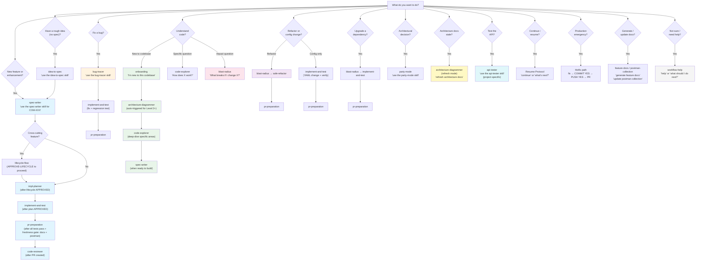

# AI-Assisted Development Workflow

> **Read time: 15 minutes** | Team-facing onboarding guide — zero human KT required
>
> For the technical engine reference, see [`AGENTS.md`](AGENTS.md). For architecture and coding standards, see [`.github/copilot-instructions.md`](.github/copilot-instructions.md).

> ⚠️ **Source of Truth**: `AGENTS.md` is the authoritative engine reference. This guide is a team-friendly summary. If any information here conflicts with `AGENTS.md`, the `AGENTS.md` version takes precedence. Sections 8–10 below are reference summaries — not independent rules.

---

## 1. What Is This Workflow

This repository uses AI skills to assist with every phase of development — writing specs, planning implementation, coding, testing, creating PRs, reviewing code, and testing the API end-to-end. You describe what you want in plain English, and the AI does the typing. You make every decision: the AI asks clarifying questions before every action, shows you what it plans to do, and waits for your explicit approval before proceeding. Nothing is committed, pushed, or merged without you saying so.

**How every interaction starts** (Request Normalization — see `AGENTS.md` §Request Normalization Protocol):
1. You describe what you want in natural language
2. AI restates your request to confirm understanding
3. AI decomposes into numbered tasks and shows you the plan
4. You confirm or adjust
5. AI executes each task one at a time, verifying each before moving to next

This ensures: no misinterpretation, no skipped steps, no drift mid-task.

All artifacts the AI produces — specifications, implementation plans, code changes, tests, and pull requests — require human approval at clearly defined gates. The AI never guesses. If it encounters something ambiguous, it stops and asks a question rather than making an assumption. Think of it as pair programming with a very thorough junior developer who reads the entire codebase before writing a single line.

**What this service does**: [Defined in project overlay AGENTS-overlay.md — see §Project Context]

---

## 2. Repository File Map

Every file that powers this workflow, who creates it, and when it matters.

| File Path | What It Is | Who Creates It | When | Who Reads It | Portable? |
|---|---|---|---|---|---|
| `AGENTS.md` | AI workflow engine — routing, phases, interaction protocol | Developer at setup | Always loaded by AI | AI (all contexts) | Portable (except `[PROJECT-SPECIFIC]` sections) |
| `.github/copilot-instructions.md` | Architecture knowledge + coding standards | Developer at setup | Auto-loaded by all Copilot contexts | AI (all contexts) | Partially portable |
| `AI-WORKFLOW.md` | This file — team-facing onboarding guide | Developer at setup | When onboarding or presenting | New developers, team | Portable (update examples) |
| `QUICKSTART.md` *(project-specific — may not exist in all projects)* | 5-command quick start | Developer at setup | First thing a new dev reads | New developers | Portable (update commands) |
| `.github/skills/*/SKILL.md` | Skill definitions (one per directory) | Developer at setup | When skill is invoked | AI (skill execution) | Layer 1 = Java/Spring Boot portable, Layer 2 = project-specific |
| `.github/skills/SUB-AGENT-CONTRACTS.md` | How skills auto-trigger other skills | Developer at setup | During skill execution | AI (cross-skill orchestration) | Portable |
| `.github/skills/implement-and-test/coding-standards-core.md` | Java/Spring Boot coding standards (core, always loaded) | Developer at setup | During implementation | AI (implement-and-test skill) | Project-specific |
| `.github/skills/implement-and-test/coding-standards-reference.md` | Full BAD/GOOD coding examples (on-demand, ~1400 lines) | Developer at setup | When core standards need elaboration | AI (implement-and-test skill) | Project-specific |
| `.github/skills/implement-and-test/test-patterns-core.md` | Test rules, coverage thresholds, checklists | Developer at setup | During testing | AI (implement-and-test skill) | Project-specific |
| `.github/skills/implement-and-test/test-patterns-reference.md` | Extended test examples and edge-case patterns (on-demand) | Developer at setup | When core test patterns need elaboration | AI (implement-and-test skill) | Project-specific |
| `.github/skills/bug-tracer/debugging-patterns.md` *(project-specific — may not exist in all projects)* | Entry points, failure modes, log correlation | Developer at setup | During debugging | AI (bug-tracer skill) | Project-specific |
| `.github/skills/code-explorer/exploration-patterns.md` *(project-specific — may not exist in all projects)* | Navigation paths and pattern guide | Developer at setup | During exploration | AI (code-explorer skill) | Project-specific |
| `.github/skills/blast-radius/core-components.md` | Critical classes list | Developer at setup | During blast-radius | AI (blast-radius skill) | Project-specific |
| `.github/skills/blast-radius/java-patterns.md` | Java/Spring grep patterns for blast-radius | Developer at setup | During blast-radius | AI (blast-radius skill) | Project-specific |
| `.github/skills/safe-refactor/refactor-checklist.md` *(project-specific — may not exist in all projects)* | Refactoring checklist | Developer at setup | During refactoring | AI (safe-refactor skill) | Project-specific |
| `.github/skills/spec-writer/spec-template.md` | Spec output format | Developer at setup | During spec writing | AI (spec-writer skill) | Project-specific |
| `.github/skills/impl-planner/impl-template.md` | Plan output format | Developer at setup | During planning | AI (impl-planner skill) | Project-specific |
| `.github/skills/lifecycle-flow/lifecycle-template.md` | Lifecycle diagram format | Developer at setup | During lifecycle mapping | AI (lifecycle-flow skill) | Project-specific |
| `.github/skills/onboarding/onboarding-guide.md` *(project-specific — may not exist in all projects)* | Codebase quick-start + gotchas | Developer at setup | During onboarding | AI (onboarding skill) | Project-specific |
| `.github/skills/pr-preparation/pr-checklist.md` | PR review checklist | Developer at setup | During PR prep + review | AI (pr-preparation skill) | Project-specific |
| `.github/skills/api-tester/SKILL.md` | API testing skill — curls, verification, reports | Developer at setup | When testing API | AI (api-tester skill) | Project-specific (Layer 2) |
| `.github/skills/api-tester/cred.md` | API keys and config (⚠️ gitignored) | Developer fills in | Before API testing | AI (api-tester skill) | Project-specific |
| `.github/skills/api-tester/error-patterns.md` | Error diagnosis knowledge base | Developer at setup | During API testing | AI (api-tester skill) | Project-specific |
| `.github/skills/api-tester/payloads/*.json` | Request payload templates per channel | AI generates from code | During API testing | AI (api-tester skill) | Project-specific |
| `.github/skills/api-tester/scripts/check-inbox.js` | Automated yopmail inbox checker (arm64/x86 Chrome auto-detected). Requires `npm install` in `api-tester/` before first use. | Developer at setup | Email delivery verification (Step 8) | AI (api-tester skill) | Project-specific |
| `.github/skills/api-tester/reports/` | Versioned test execution reports | AI generates per run | After API testing | Developer + AI | Project-specific |
| `features/<ticket-id>/spec.md` | Feature specification | AI (spec-writer skill) | After spec-writer runs | AI + Developer (approval gate) | Generated per feature |
| `features/<ticket-id>/plan.md` | Implementation plan | AI (impl-planner skill) | After impl-planner runs | AI + Developer (approval gate) | Generated per feature |
| `features/<ticket-id>/lifecycle.md` | Cross-service flow diagram | AI (lifecycle-flow skill) | After lifecycle-flow runs | AI + Developer (approval gate) | Generated per feature (optional) |
| `.github/kt/` *(folder)* | Persistent KT documents generated by onboarding skill (10 files: architecture, event-story, patterns, gotchas, local-setup, ai-workflow, README + 3 diagrams). Team commits these so every future developer reads the same KT. | AI (onboarding skill, Step 7) | When developer says YES to KT generation during L2+ onboarding | Developer + AI | Project-specific (regenerate per repo) |

---

## 3. Sub-Agent Contracts: Who, When, Which Step

Skills don't work in isolation. When a skill needs analysis, exploration, or diagramming, it automatically invokes another skill as a sub-agent. These triggers are defined in [`.github/skills/SUB-AGENT-CONTRACTS.md`](.github/skills/SUB-AGENT-CONTRACTS.md).

### Summary Table

| Parent Skill | Sub-Agent | At Which Step | Input | Output | Blocking? |
|---|---|---|---|---|---|
| spec-writer | code-explorer | Step 3 — always | Feature description + domain terms | Related classes, patterns, constants | Yes |
| spec-writer | architecture-diagrammer | Step 4 — when cross-cutting | Feature scope + components | Component interaction diagram | Yes |
| lifecycle-flow | code-explorer | When component unclear | Class name | Explanation + dependencies | Yes |
| lifecycle-flow | architecture-diagrammer | After lifecycle.md created | Feature scope + involved components | Component interaction diagram | Yes |
| impl-planner | blast-radius | Step 3 — for every change point | File path + change description | Risk level + callers table | Yes |
| implement-and-test | blast-radius | Step 8 — when risk MEDIUM+ | Changed file paths | Risk assessment | Yes |
| pr-preparation | blast-radius | Step 2 — always | All changed files | Aggregate risk for PR body | Yes |
| code-reviewer | blast-radius | Step 2 — always | All changed classes in diff | Per-file risk level | Yes |
| bug-tracer | code-explorer | Step 2 — always | Search terms + symptom | Entry points, call chain | Yes |
| bug-tracer | blast-radius | Step 7 — after root cause found | Root cause file + fix description | Risk of the fix | Yes |
| safe-refactor | blast-radius | Phase 1 — always | Target + change type | Risk report + callers | Yes |
| onboarding | code-explorer | Steps 3/5/6 — on-demand | Class name or flow | Explanation with file refs | Yes |
| onboarding | architecture-diagrammer | Step 2 — default for Level 2+ | "Generate system overview" | Architecture diagram | Yes |
| architecture-diagrammer | code-explorer | Step 2 — when role unclear | Class name | Purpose + dependencies | Yes |

### Contract Narratives

**blast-radius (Sub-Agent)**
When a parent skill (impl-planner, pr-preparation, code-reviewer, safe-refactor, bug-tracer, or implement-and-test) identifies a class or method that will be modified, it automatically triggers blast-radius. The blast-radius skill searches the codebase for all callers, Spring DI references, and configuration bindings of the target. It returns a structured report with a risk level (LOW / MEDIUM / HIGH / CRITICAL) and a table of direct callers. The parent skill blocks until this report arrives, then incorporates the risk assessment into its own output — for example, impl-planner adds risk levels to each task, and pr-preparation includes an aggregate risk summary in the PR body. The developer sees the risk ratings inline, not as a separate step.

**code-explorer (Sub-Agent)**
When a parent skill (spec-writer, onboarding, bug-tracer, lifecycle-flow, or architecture-diagrammer) encounters an unfamiliar component or needs to understand existing patterns, it automatically triggers code-explorer. The code-explorer navigates the source tree, reads the relevant files, and returns an explanation of the component's purpose, its dependencies, who calls it, and related classes — all with file:line references. The parent skill blocks until the explanation arrives, then uses that context to inform its own work. The developer sees this as the AI "reading the codebase" — it happens transparently, and the results appear as context in the parent skill's output.

**safe-refactor (Sub-Agent)**
Unlike other sub-agents, safe-refactor is not fully automatic. The typical flow is: developer invokes blast-radius on a refactoring target, reviews the risk report, confirms the scope, and then invokes safe-refactor. The safe-refactor skill executes bottom-up — starting from leaf files (fewest callers) and working toward entry points. After each file change, it runs `./mvnw test` to catch breakage early. The developer sees a step-by-step progression: file renamed → tests pass → next file → tests pass → done. If any test fails, the skill stops and reports which change caused the failure.

**architecture-diagrammer (Sub-Agent)**
When spec-writer detects a cross-cutting feature, onboarding reaches Level 2+ depth, or lifecycle-flow finishes creating a sequence diagram, the parent skill automatically triggers architecture-diagrammer. It reads the source code to identify components and their relationships, then produces Mermaid diagrams — saved to `.github/kt/diagrams/` or embedded in the feature's spec. The developer sees the diagram appear as part of the parent skill's output.

---

## 4. Skill Map

| I want to... | Skill | What it does | Output |
|---|---|---|---|
| Build a new feature | `spec-writer` | Writes structured spec from your description | `features/<ticket-id>/spec.md` |
| Crystallize a rough idea | `idea-to-spec` | 5 structured questions → brief.md that feeds spec-writer | `features/<ticket-id>/brief.md` |
| Plan the implementation | `impl-planner` | Complexity-assessed (XS→XL) task list with file paths + blast-radius | `features/<ticket-id>/plan.md` |
| Write code + tests | `implement-and-test` | Implements each task, writes tests, runs verify | Modified code + passing tests |
| Prepare a PR | `pr-preparation` | Runs checklist, creates commit + PR | PR on GitHub |
| Review a PR | `code-reviewer` | 5-phase deep review (architecture, security, performance, production, Java). Supports parallel multi-PR review. Posts verdict to GitHub on request. | Review verdict (posted to GitHub on request) |
| Fix a bug | `bug-tracer` | Traces root cause through call chain | Root cause + suggested fix |
| Understand code | `code-explorer` | Navigates and explains any class/flow/pattern | Explanation with file:line refs |
| Check impact of change | `blast-radius` | Finds all callers + risk assessment | Impact report |
| Rename/reorganize | `safe-refactor` | Bottom-up refactor with test between each step | Refactored code + passing tests |
| Onboard to codebase | `onboarding` | Tiered walkthrough (L0–L3) of architecture + patterns | Understanding + KT docs (.github/kt/) |
| Generate diagrams | `architecture-diagrammer` | Mermaid diagrams from source code analysis | Diagrams in `.github/kt/diagrams/` |
| Map cross-service flows | `lifecycle-flow` | Sequence diagrams for REST→Kafka routing pipeline | `features/<ticket-id>/lifecycle.md` |
| Test dispatcher API | `api-tester` | 3-layer drift detection (DTO/config/FTL). Auto-generates payloads from sample curls. Fires curls, verifies delivery, diagnoses errors. | Versioned test reports in `reports/` |
| Discuss architectural tradeoffs | `party-mode` | Multi-persona (PM/Arch/Dev/SecRev/SRE) discussion → decision summary with code implications | Decision summary in terminal |
| Get help / unsure what to do | `workflow-help` | Context-aware routing — detects your state and recommends the correct next skill | Skill recommendation with exact invocation phrase |
| Check my dev environment | `setup-check` | Verifies AI tooling prerequisites (gh, copilot, auth, Node.js, plugins). Auto-runs before first skill. | Setup status report + guided installation |
| Generate/update feature docs | `feature-docs` | Generates/updates feature documentation (README, design, architecture, flow, testing, integration) per phase | `features/<ticket-id>/` docs folder |
| Generate/update Postman collection | `postman-collection` | Generates/updates Postman collection + environment for API endpoints | `postman/` collection + environment files |

---

## 5. Start Here Decision Tree



> **Understand-then-build path**: If you're new to the codebase and need to build a feature, follow the green path: `onboarding` → `architecture-diagrammer` (auto-triggered) → `code-explorer` (deep-dive) → `spec-writer` (when ready to build). This gives you full context before writing a single line of code.

---

## 6. End-to-End Worked Examples

### Example 1: New Developer Zero Knowledge → Understand → Build First Feature

**Scenario**: You just joined the team. You have no context on the dispatcher. You need to understand it, then add a new API key for a new consuming service (COM-612).

```
Step 1 — Onboarding

Developer: "I'm new to this codebase"
AI (onboarding skill): "Welcome! I'll walk you through this codebase. A few questions first:
  1. What's your role? (backend dev, QA, tech lead)
  2. How familiar are you with Spring Boot / Kafka / Redis?
  3. Any specific area you'll be working on?"
Developer: "Backend dev, familiar with Spring Boot, I'll be working on security and API keys"

→ AI walks through architecture levels L0–L3:
  - L0: High-level system purpose (API gateway for notification routing)
  - L1: Request pipeline (REST → SecurityFilter → Controller → Validator → Config → Kafka)
  - L2: Auto-triggers architecture-diagrammer → generates system overview diagram
  - L3: Deep-dive into SecurityFilter and API key validation flow
→ Output: Developer understands the codebase, architecture diagrams saved to .github/kt/diagrams/

Step 2 — Deep-Dive with Code Explorer

Developer: "How does SecurityFilter validate API keys? Show me the full flow."
AI (code-explorer skill): Reads SecurityFilter, SecurityConfig, application.yml
→ Returns explanation with file:line refs for each component

Step 3 — Build the Feature

Developer: "use the spec-writer skill for COM-612 — add new API key for loyalty service"
AI (spec-writer skill): "I'll write the spec. A few questions first:
  1. What is the service name? (used in security.api.keys map)
  2. Should this key have access to v1 only, v2 only, or both?
  3. Any site restrictions (mafbhr, mafkwt require x-maf-account)?"
Developer: "loyalty, v2 only, no site restrictions"
→ AI auto-triggers code-explorer to verify SecurityConfig patterns
→ Writes features/COM-612/spec.md
Developer: "APPROVE"

→ AI (impl-planner skill): Creates task list, auto-triggers blast-radius on SecurityConfig
→ Writes features/COM-612/plan.md with risk levels per task
Developer: "APPROVE"

→ AI (implement-and-test skill): Updates SecurityConfig, application.yml, adds test
→ Runs ./mvnw verify → all pass

→ AI (pr-preparation skill): "Here's what I'll commit:
  - 2 modified files (SecurityConfig + application.yml)
  - Commit: feat(security): add loyalty service API key [COM-612]
  - Branch: feat/COM-612/loyalty-api-key
  Commit this?"
Developer: "COMMIT YES"
→ Commit created.
→ AI: "Push to origin/feat/COM-612/loyalty-api-key?"
Developer: "PUSH YES"
→ PR created on GitHub
→ AI: "PR #N created. Phase 6 (code-review) is available — say `review PR #N` when ready."
```

### Example 2: Bug in Dev → Trace → Fix → PR

**Scenario**: Dev environment — config ID resolution is failing for mafbhr site. Getting 400 "Notification not supported".

```
Step 1 — Trace the Bug

Developer: "use the bug-tracer skill — 400 not supported for mafbhr, event: order_shipped"
AI (bug-tracer skill): "I'll trace this. Let me ask a few questions:
  1. Which environment? (local / dev / preprod)
  2. When did this start? (after a deployment? config change?)
  3. Is it all events for mafbhr or just order_shipped?
  4. Do you have the request payload or correlation ID?
  5. Any relevant log lines?"
Developer: "dev, started after yesterday's deploy, only order_shipped, have the curl"

→ AI auto-triggers code-explorer to map the call chain:
  CommunicationController.sendNotification() → RequestValidatorServiceImpl.validateRequest()
  → ConfigServiceCircuitBreakerImpl.getConfig() → MongoDB lookup
→ AI traces: Config ID = "fulfillment_mafbhr_order_shipped" (lowercase)
→ Checks MongoDB pattern: found "fulfillment_mafbhr_ORDER_SHIPPED" (mixed case)
→ Root cause: Config ID in MongoDB has uppercase event name, but RequestValidatorServiceImpl
  lowercases the event before lookup
→ AI auto-triggers blast-radius on RequestValidatorServiceImpl.getConfigId()
→ Risk assessment: LOW (fix is in config data, not code)

Step 2 — Present Options (STOP — multiple valid approaches)

→ AI: "I found two valid fix approaches. Which do you prefer?
  Option A: Update MongoDB config entry to use lowercase event name (config-only, zero code risk)
  Option B: Add case-insensitive lookup in ConfigServiceCircuitBreakerImpl (code change, affects all lookups)
  I recommend Option A — it's config-only with zero blast-radius."
Developer: "A"

Step 3 — Fix and Test

→ AI (implement-and-test skill):
  - Updates MongoDB config entry to use lowercase event name
  - Writes regression test verifying case-insensitive config resolution
  - Runs ./mvnw test → all pass

Step 4 — Create PR

→ AI (pr-preparation skill): "Commit: fix(config): normalize config ID case for mafbhr [COM-XXX]
  Branch: fix/COM-XXX/mafbhr-config-case
  1 modified file, 1 new test. Commit this?"
Developer: "COMMIT YES"
→ Commit created.
→ AI: "Push to origin/fix/COM-XXX/mafbhr-config-case?"
Developer: "PUSH YES"
→ PR created on GitHub
→ AI: "PR #N created. Phase 6 (code-review) is available — say `review PR #N` when ready."
```

### Example 3: New Feature → Full 6-Phase Workflow

**Scenario**: Add a new Kafka priority level — CRITICAL priority for emergency notifications that bypass the standard queue. All sites.

```
Phase 1 — Spec

Developer: "use the spec-writer skill for COM-575 — add CRITICAL priority Kafka topic"
→ AI asks clarifying questions about topic naming, when CRITICAL applies, producer routing
→ AI auto-triggers code-explorer to examine existing KafkaProducer topic routing
→ AI auto-triggers architecture-diagrammer (cross-cutting: new topic + routing change)
→ Writes features/COM-575/spec.md
Developer: "APPROVE"

Phase 2 — Lifecycle Flow (auto-suggested because cross-cutting)

→ AI (lifecycle-flow skill): "This is a cross-cutting feature — new Kafka topic affects
  ProducerServiceImpl routing, KafkaProducer topic selection, and downstream consumer config.
  I'll map the full lifecycle."
→ AI auto-triggers code-explorer for component behaviors
→ Writes features/COM-575/lifecycle.md with sequence diagrams
Developer: "APPROVE-LIFECYCLE"

Phase 3 — Implementation Plan

→ AI (impl-planner skill): Creates 5 tasks:
  1. Add CRITICAL topic constant to KafkaProducer [blast-radius: LOW]
  2. Add priority field to CommunicationDTO [blast-radius: HIGH — all requests use this]
  3. Update ProducerServiceImpl.validateAndSend() routing logic [blast-radius: MEDIUM]
  4. Add CRITICAL topic config to application.yml for all profiles [blast-radius: LOW]
  5. Update RequestValidatorServiceImpl to validate priority field [blast-radius: LOW]
→ Writes features/COM-575/plan.md
Developer: "APPROVE"

Phase 4 — Implement and Test

→ AI (implement-and-test skill): Implements all 5 tasks
→ Writes KafkaProducerTest, ProducerServiceImplTest updates
→ Runs ./mvnw verify → all pass

Phase 5 — PR Preparation

→ AI (pr-preparation skill): Auto-triggers blast-radius on all changed files
→ Shows: 2 new files, 5 modified files, aggregate risk: MEDIUM
→ "Commit: feat(kafka): add CRITICAL priority topic for emergency notifications [COM-575]
  Branch: feat/COM-575/critical-priority-topic. Commit this?"
Developer: "COMMIT YES"
→ Commit created.
→ AI: "Push to origin/feat/COM-575/critical-priority-topic?"
Developer: "PUSH YES"
→ PR created on GitHub
→ AI: "PR #N created. Phase 6 (code-review) is available — say `review PR #N` when ready."

Phase 6 — Code Review

Developer (or reviewer): "give me all open PRs"
→ AI (code-reviewer skill) runs `gh pr list --state open` → displays table
Developer: "review #42"
→ AI asks: "Quick scan or deep review? Specific concerns? Related spec?"
Developer: "deep review, no concerns, spec exists"
→ AI runs 5-phase review, verifies all acceptance criteria from spec.md
→ Verdict: APPROVE with 0 blocking issues
→ AI asks: "Shall I post this review to GitHub?"
Developer: "YES"
→ `gh pr review 42 --approve --body "..."` — review posted
```

### Example 4: Enhancement → Partial Workflow

**Scenario**: Add x-maf-account validation for a new site (mafegy) that previously didn't require it.

```
Developer: "use the spec-writer skill for COM-489 — add x-maf-account validation for mafegy"

→ AI (spec-writer skill): Reads existing SecurityFilter and RequestValidatorServiceImpl
→ AI auto-triggers code-explorer to understand current site-based validation
→ Asks: "mafbhr and mafkwt currently require x-maf-account with values
  {hypermax, majidalfuttaim}. Should mafegy use the same allowed values?"
Developer: "Yes, same values"
→ Writes delta spec — ONLY the mafegy addition
→ features/COM-489/spec.md
Developer: "APPROVE"

→ AI (impl-planner skill): 2 tasks:
  1. Add mafegy to site-based validation in RequestValidatorServiceImpl [blast-radius: MEDIUM]
  2. Update integration tests for mafegy validation [blast-radius: LOW]
→ features/COM-489/plan.md
Developer: "APPROVE"

→ implement-and-test: Implements 2 tasks, adds test
→ ./mvnw verify → passes

→ pr-preparation: "Commit: feat(security): add x-maf-account validation for mafegy [COM-489]. Commit this?"
Developer: "COMMIT YES"
→ AI: "Push to origin/feat/COM-489/...?"
Developer: "PUSH YES" → PR created
→ AI: "PR #N created. Phase 6 (code-review) is available — say `review PR #N` when ready."
```

### Example 5: Refactor → blast-radius → safe-refactor → PR

**Scenario**: Rename `ProducerServiceImpl.validateAndSend()` to `ProducerServiceImpl.routeNotification()` — the name is misleading since it does routing, not just validation.

```
Step 1 — Assess Impact

Developer: "use the blast-radius skill on ProducerServiceImpl.validateAndSend"
→ AI (blast-radius skill): Searches codebase for all references
→ Report:
  - Risk: MEDIUM
  - Direct callers: 3 (CommunicationController, 2 test classes)
  - Spring DI references: 1 (bean injection via constructor)
  - Limitations: grep-based — verify with IntelliJ Find Usages.

Step 2 — Execute Refactoring

Developer: "use the safe-refactor skill — rename ProducerServiceImpl.validateAndSend to routeNotification"
→ AI (safe-refactor skill): Reads blast-radius report, plans bottom-up execution
→ Execution sequence:
  1. Rename method in ProducerServiceImpl.java
  2. ./mvnw test → pass ✅
  3. Update CommunicationController (primary caller)
  4. ./mvnw test → pass ✅
  5. Update 2 test classes
  6. Final ./mvnw verify → all pass ✅

Step 3 — Create PR

→ AI (pr-preparation skill): "Commit: refactor(producer): rename validateAndSend to
  routeNotification [COM-XXX]
→ Branch: refactor/COM-XXX/rename-validate-and-send
→ 4 files changed. Commit this?"
Developer: "COMMIT YES"
→ AI: "Push to origin/refactor/COM-XXX/rename-validate-and-send?"
Developer: "PUSH YES" → PR created
→ AI: "PR #N created. Phase 6 (code-review) is available — say `review PR #N` when ready."
```

### Example 6: Test the Dispatcher API → End-to-End Verification

**Scenario**: Test the gift card email flow on preprod to verify delivery.

```
Developer: "use the api-tester skill"
AI: "Which environment? [local / dev / preprod]"
Developer: "preprod"
AI: "Which test cases? [TC-EMAIL-001 / all P0 / specific]"
Developer: "TC-EMAIL-001"

→ AI loads cred.md, resolves API key for preprod
→ Shows resolved curl (API key REDACTED in display):
  POST https://[project-service]-preprod.mafrservicesstg.com/notification/v2/send
  x-api-key: [REDACTED]
  Body: gift_card_ogloba payload → api-test-{timestamp}@yopmail.com
→ "Fire this curl? [YES / NO]"
Developer: "YES"

→ HTTP 202 Accepted (0.259s)
→ Waits 10s → checks yopmail inbox for api-test-{timestamp}@yopmail.com
→ Email found! Subject: "Your Gift Card" — delivered in 8s

→ AI: "✅ TC-EMAIL-001 PASS — HTTP 202, email delivered in 8s"
→ Generates reports/send-email/sendemail-v1.md
→ Updates P0-test-cases.md registry (at .github/skills/api-tester/P0-test-cases.md)

→ "Run more tests, or save report? [more / done]"
```

---

### Example 7: Payload Drift Detection — DTO Field Renamed After Code Change

**Scenario**: Developer renames `notificationData` field in a DTO. api-tester detects the stale payload before any test fires.

```
Developer: "check drift"

→ AI runs: node .github/skills/api-tester/detect-drift.js --verbose

[detect-drift] Parsing DTO source files...
[detect-drift]   CommunicationDTO: 4 required, 2 optional, 2 system-only, 6 hidden
[detect-drift] Scanning 4 payload file(s): send-email.json, send-sms.json, send-push.json, send-whatsapp.json

[detect-drift]   ✅ send-sms.json — OK
[detect-drift]   ✅ send-push.json — OK
[detect-drift]   ✅ send-whatsapp.json — OK
[detect-drift]   ❌ send-email.json — DRIFT
[detect-drift]      ❌ REMOVED top-level: notificationData — field no longer in DTO, possible rename

[detect-drift] === Summary ===
[detect-drift] ✅ OK: 3  ⚠️  WARN: 0  ❌ DRIFT: 1  ✏️  FIXED: 0
[detect-drift] ❌ Drift detected — payload(s) do not match current DTO.

AI: ❌ Drift found in send-email.json:

  REMOVED: notificationData — no longer in DTO (renamed or deleted)
  This field was in your payload but is not in CommunicationDTO.java

  What would you like to do?
  [Auto-fix NEW fields] [Skip — drift is intentional] [Show verbose] [Show DTO first]
```

Developer selects **"Show DTO first"**:
```
→ AI reads: src/main/java/com/maf/oms/communication/dto/request/CommunicationDTO.java
→ AI: "Found field 'communicationData' (was 'notificationData'). Looks like a rename."
→ AI: "send-email.json still uses 'notificationData'. Shall I update the payload?"
Developer: "YES"

→ AI edits send-email.json: renames notificationData → communicationData
→ Re-runs: node detect-drift.js

[detect-drift] ✅ OK: 4  ⚠️  WARN: 0  ❌ DRIFT: 0
→ "✅ Layer 1 clean. Running Layer 2 config validation..."
```

**Layer 1 (DTO) drift output — field status legend**:

| Output | Meaning | Action |
|---|---|---|
| `✅ OK` | Payload matches DTO exactly | Nothing to do |
| `⚠️ WARN — DEPRECATED` | Payload uses a `@Deprecated` field (still works) | Migrate when convenient |
| `⚠️ WARN — NEW optional` | DTO has a new optional field not yet in payload | Run `--fix` to add it, or ignore |
| `❌ DRIFT — REMOVED` | Payload field no longer exists in DTO | Investigate: was it renamed? deleted? |
| `❌ DRIFT — SYSTEM_ONLY` | Payload sends a `@Null` field (e.g. `eventWeightage`) | Remove it — dispatcher will return 400 |
| `❌ DRIFT — recipients` | Recipient field removed from Recipients.java | Update payload recipients block |

**Layer 2 (config) output legend**:

| Output | Blocking? | Action |
|---|---|---|
| `✅ VALID` | No | Proceed |
| `⚠️ CONFIG CHANGED` | No | AI shows diff, asks "proceed?" |
| `⚠️ TEMPLATE MISMATCH` | No | Verify template name vs MongoDB config |
| `❌ MISSING` | **Yes** | Create config in MongoDB first |
| `❌ DISABLED` | **Yes** | Re-enable config in MongoDB |
| `❌ CHANNEL DISABLED` | **Yes** | Enable channel in MongoDB config |

**Layer 3 (FTL) output legend**:

| Output | Blocking? | Action |
|---|---|---|
| `✅ FTL MATCH` | No | Proceed |
| `⚠️ MISSING IN PAYLOAD` | No | Ask: system-injected or caller must send? |
| `⚠️ POSSIBLY UNUSED` | No | Do not remove — may be used in lang variants |
| `⚠️ No FTL files found` | No | Normal for some events — emit log message, then proceed |

**Drift exit codes** (useful in CI scripts):
```bash
node detect-drift.js; echo "Exit: $?"
# 0 = OK or WARN only (non-blocking)
# 1 = DRIFT found (must fix before testing)
# 2 = Parse error (DTO files missing or unreadable)

node config-validator.js payloads/send-email.json --env preprod; echo "Exit: $?"
# 0 = OK or WARN (testing may proceed)
# 1 = BLOCKED (MISSING/DISABLED/CHANNEL_DISABLED — fix before testing)
# 2 = Script/network error

node ftl-checker.js payloads/send-sms.json --comm-service-path /path/to/comm-service; echo "Exit: $?"
# 0 = always (FTL check never blocks)
```

---

## 7. Workflow Summary and Gates

### Complete Chain with Auto-Triggers

```
Full Feature Workflow:
  spec-writer ──APPROVE──► lifecycle-flow (if cross-cutting) ──APPROVE-LIFECYCLE──► impl-planner ──APPROVE──► implement-and-test ──auto──► pr-preparation ──COMMIT YES + PUSH YES──► code-reviewer
       │                        │                                                       │                          │                         │
       ├► code-explorer         ├► code-explorer                                        ├► blast-radius            ├► blast-radius           ├► blast-radius
       └► arch-diagrammer       └► arch-diagrammer                                      (every change point)       (if MEDIUM+ risk)         (all changed files)
```

### Approval Gates

| Transition | Human Action |
|---|---|
| spec-writer → lifecycle-flow | Type `APPROVE` on spec.md (auto-routes to lifecycle if cross-cutting) |
| lifecycle-flow → impl-planner | Type `APPROVE-LIFECYCLE` on lifecycle.md |
| spec-writer → impl-planner | Type `APPROVE` on spec.md (direct if not cross-cutting) |
| impl-planner → implement-and-test | Type `APPROVE` on plan.md |
| implement-and-test → pr-preparation | Automatic (all tests pass) |
| pr-preparation → commit | Type `COMMIT YES` (after reviewing diff + message) |
| pr-preparation → push | Type `PUSH YES` (after reviewing target remote/branch) |
| code-reviewer → merge | Standard GitHub review approval |

### Fast-Track Paths (Reduced Gates)

| Scenario | Path | Gates |
|---|---|---|
| Bug fix | bug-tracer → implement-and-test → pr-preparation | COMMIT YES + PUSH YES |
| Config-only change | implement-and-test → pr-preparation | COMMIT YES + PUSH YES |
| Refactoring | blast-radius → safe-refactor → pr-preparation | COMMIT YES + PUSH YES |
| Dependency upgrade | blast-radius → implement-and-test → pr-preparation | COMMIT YES + PUSH YES |

---

## 8. Safety Rules

> These rules are enforced by the AI at all times. No skill or shortcut can bypass them.

### Git Safety

1. **No commits without approval** — the AI always shows the diff summary and proposed commit message first, then waits for your explicit `COMMIT YES`.
2. **No pushes without approval** — the AI shows the target remote/branch and commit list, then waits for `PUSH YES`.
3. **Protected branches are off-limits** — `release`, `master`, and `main` are never checked out, committed to, or pushed to directly. All work happens on feature branches.
4. **No branch deletion without approval** — the AI shows which branch and why before deleting.
5. **No force-push or risky rebase** — if conflicts exist or history rewrite is needed, the AI stops and asks.
6. **No auto-merge** — the AI never merges branches without explicit user approval.
7. **If in doubt, STOP** — if any git operation feels risky, the AI stops and asks rather than proceeding.

### Approval Sequence (for every code change)

```
Code changes → AI shows diff → "Commit this?" → COMMIT YES
→ AI shows commit message → commits
→ "Push to {remote}/{branch}?" → PUSH YES → pushes
→ PR created → AI informs: "PR #N created. Phase 6 (code-review) available."
```

> Two separate approvals are required. A single "YES" is not sufficient — the AI must receive explicit `COMMIT YES` and `PUSH YES` as separate steps. See `AGENTS.md` §Absolute Safety Rules for the authoritative version.

### Pre-Flight Environment Check

Before your first skill invocation, the AI silently verifies your environment (GitHub CLI, Copilot CLI, Node.js, auth). If anything is missing, it guides you through setup — always asking permission before installing anything. See Section 10 → `setup-check` for details.

### Anti-Hallucination Guarantee

The AI follows strict verification rules to prevent inventing facts:
- **Every factual claim cites a source** (`file:line`, grep output, or graph query). If no source exists, the claim is marked `[ASSUMPTION]`.
- **Never invents class names, method signatures, or config keys.** Always verifies via grep before referencing.
- **Architecture claims require evidence** — "X calls Y" must be backed by grep, graphify, or file contents.
- **When unsure, says "I'm not sure"** rather than guessing confidently.

See `AGENTS.md` §Anti-Hallucination Rule for the full authoritative version.

---

## 9. Power Features

| Feature | How to use | What happens |
|---|---|---|
| **Auto blast-radius** | Automatic in planning + PR prep + review | Finds all callers, rates risk LOW/MEDIUM/HIGH/CRITICAL |
| **Architecture diagrams** | `"generate a system diagram"` or auto during onboarding | Reads source, produces Mermaid diagrams in `.github/kt/diagrams/` |
| **Layer 1 drift detection** | Automatic in api-tester (always) | `detect-drift.js` — detects when DTO field names change vs stored payloads. Blocking on DRIFT. |
| **Layer 2 config validation** | Automatic in api-tester (always) | `config-validator.js` — validates MongoDB config: exists, enabled, channel active, templates match. Blocking on MISSING/DISABLED. |
| **Layer 3 FTL template check** | Automatic in api-tester if `commServicePath` set in cred.md | `ftl-checker.js` — compares payload placeholders vs FTL DTO variables. WARN only, never blocks. Supports local path or GitHub URL. |
| **Yopmail email verification** | Automatic in api-tester after email tests | Checks yopmail inbox programmatically via easy-yopmail |
| **API key REDACTION** | Automatic in api-tester | All curls and reports have keys replaced with [REDACTED] |
| **Cross-site impact** | Automatic in spec writing | Checks if change affects 1 or multiple sites, lists impacted site codes |
| **Test pattern matching** | During implement-and-test | Generates tests matching existing `@ExtendWith(MockitoExtension.class)` patterns |
| **Idempotent skills** | Run any skill twice safely | Updates existing artifacts, never duplicates or corrupts |
| **Fast-track paths** | Bug fix, config, refactor | Skip spec+plan for routine changes (see Section 7) |
| **Understand-then-build** | `"I'm new, then build feature"` | Seamless chain: onboarding → architecture-diagrammer → code-explorer → spec-writer |
| **Workflow help** | `"help"` or `"what should I do next?"` | Context-aware routing — detects your state and recommends the correct next skill |
| **Design rationale mode** | `"Why is X built this way?"` | Explains design decisions by reading code structure + patterns |
| **Sub-agent auto-triggers** | Happens transparently | Skills invoke blast-radius, code-explorer, architecture-diagrammer automatically |
| **Party-mode discussions** | `"use the party-mode skill — [question]"` | Multi-persona (PM, Arch, Dev, SecRev, SRE) debate with decision summary + code implications |
| **Versioned test reports** | Automatic in api-tester | Each test run creates sendemail-v1.md, v2.md, etc. History preserved. |

---

## 10. How to Use Each Skill — Complete Reference

Quick reference for every skill: exact invocation phrase, what the AI asks, what it produces, and what you do next.

---

### 🔧 setup-check (auto-triggered or manual)
**When**: Automatically before your first skill invocation in a session. Or manually when you want to verify your environment.

**Invoke (manual)**:
```
check my setup
```

**What it checks** (global prerequisites):
1. GitHub CLI (`gh`) installed
2. GitHub CLI authenticated (`gh auth status`)
3. Copilot access (CLI, VS Code, or IntelliJ — any one)
4. Graphify installed (recommended — graphify-first applies when a graph exists)
5. Graphify graph fresh (<7 days; update stale graphs with `graphify . --update` or `/graphify --update`)

**Project-specific checks** (added by project overlays):
- Maven wrapper / npm / go (detected from project type)
- Node.js (if project uses api-tester or inbox verification)
- easy-yopmail (if project uses email verification)

**If all pass**: Silent — you never see setup-check output. The requested skill starts immediately.

**If any fail**: Shows ✅/❌ status table → asks permission to install each missing tool → presents IDE plugin checklist (GitHub Copilot, Mermaid).

**Auto-triggers**: None (leaf)

**Time**: Instant if all checks pass. ~5 min for guided setup.

---

### ⚪ workflow-help (start here if unsure)
**When**: You don't know which skill to use, or you want to see all available options.

**Invoke**:
```
help
```
Or:
```
what should I do next?
```

**3 modes**:
1. **Show All**: `"show all skills"` → displays full skill table with purpose and invocation
2. **Known State**: `"spec is approved for COM-789, what's next?"` → routes directly to `impl-planner`
3. **Ambiguous**: `"I need to change the security config"` → asks 1-2 clarifying questions → routes to correct skill

**Output**: A specific skill recommendation with exact invocation phrase. Never more than 2 clarifying questions to reach a recommendation.

**Auto-triggers**: None (router only)

**Time**: Instant — routes in under 1 min

---

### 🟢 idea-to-spec
**When**: You have a rough idea but no formal requirements. This turns your verbal concept into a structured brief.md that feeds spec-writer.

**Invoke**:
```
use the idea-to-spec skill for COM-XXX — [rough idea description]
```
Or without a Jira ticket:
```
use the idea-to-spec skill — we need rate limiting on the v2 endpoint
```

**AI asks 5 structured questions** (one at a time):
1. What is the core problem? What does the user/system need?
2. What triggers this? Where does the request originate?
3. Which pipeline stages are affected? (SecurityFilter / Controller / Validator / Config / Kafka)
4. What does success look like? (2-3 acceptance criteria)
5. What is explicitly NOT included?

**Auto-triggers**: `code-explorer` (Step 3 — checks if similar pattern exists)

**Output**: `features/<ticket-id>/brief.md` — a structured pre-spec document

**Your action**: Review brief.md → AI gives you the exact spec-writer invocation. Say YES to auto-transition.

**Next step**: `spec-writer` (reads brief.md automatically, skips questions already answered)

**Time**: ~5 min

---

### 🔵 spec-writer
**When**: Starting any new feature, enhancement, or work that needs a written spec and approval gate.

**Invoke**:
```
use the spec-writer skill for COM-XXX [brief description]
```

**AI asks first** (mandatory):
- Is this new or extending existing? What already exists?
- Which pipeline stages are affected? (Security / Controller / Validator / Config / Kafka)
- Which sites? (mafuae, mafsau, mafbhr, mafkwt, all)
- What triggers the change?
- Business rules / edge cases?
- What is explicitly OUT OF SCOPE?

**Auto-triggers**: `code-explorer` (Step 3 — always), `architecture-diagrammer` (Step 4 — if cross-cutting), `lifecycle-flow` (Phase 2 handoff — if cross-cutting)

**Output**: `features/COM-XXX/spec.md` (Status: DRAFT)

**Your action**: Read the spec → type `APPROVE` or `REVISE: [what's wrong]`

**Next step**: `impl-planner` automatically (after APPROVE)

**Time**: ~5–10 min

---

### 🔵 impl-planner
**When**: After spec.md is APPROVED and you're ready to plan the implementation tasks.

**Invoke**:
```
use the impl-planner skill for COM-XXX
```
*(AI reads features/COM-XXX/spec.md automatically)*

**Step 0 — Complexity Assessment**: AI first assesses XS/S/M/L/XL complexity:
- **XS**: Inline tasks (no plan.md) — e.g., add a site code to YAML
- **S**: Minimal plan.md (tasks only) — e.g., new API key using existing SecurityConfig pattern
- **M**: Standard plan.md — e.g., new validation rule for a site
- **L**: Detailed plan.md + rollback strategy — e.g., new Kafka topic with routing changes
- **XL**: Full plan.md + ADR — e.g., new security mechanism replacing x-api-key

**AI asks first**: "Complexity: [TIER]. Agree?" before proceeding.

**Auto-triggers**: `blast-radius` on every change point in the plan

**Output**: `features/COM-XXX/plan.md` with tasks, file paths, risk levels, complexity tier (Status: DRAFT)

**Your action**: Review task list + risk levels → type `APPROVE` or `REVISE: [changes]`

**Next step**: `implement-and-test` (after APPROVE)

**Time**: ~10–15 min

---

### 🔵 implement-and-test
**When**: After plan.md is APPROVED, or directly for config-only / fast-track changes.

**Invoke**:
```
use the implement-and-test skill for COM-XXX
```
Or for fast-track (no plan needed):
```
use the implement-and-test skill — config only: add mafegy to site validation
```

**AI asks first** (work-type specific):
- For new feature: Any implementation ambiguities in the plan?
- For config: Which profiles? Which sites? Any YAML format questions?
- For bug fix: Is the root cause confirmed? Which test should cover the regression?

**Auto-triggers**: `blast-radius` after implementation if risk is MEDIUM+

**Output**: Modified/new Java files + tests. Runs `./mvnw verify` — must pass before exit.

**Your action**: Review changed files → proceed to `pr-preparation`

**Time**: 15–45 min depending on scope

---

### 🔵 pr-preparation
**When**: All tasks done, all tests pass, ready to commit and create a PR.

**Invoke**:
```
use the pr-preparation skill for COM-XXX
```

**Step 0 — Freshness gate** (runs before anything else):
- Checks if `feature-docs` are fresh (generated after implementation). If stale → auto-triggers regeneration.
- Checks if `postman-collection` is fresh (matches current endpoints). If stale → auto-triggers regeneration.
- Only proceeds to commit once both are fresh.

**AI asks first**:
- Is this the complete set of changes, or are more tasks coming?
- Any known issues to note in the PR body?

**Auto-triggers**: `blast-radius` on all changed files (for PR body risk summary), `feature-docs` (if stale), `postman-collection` (if stale)

**Output**: Shows you:
- List of all changed files
- Proposed commit message (format: `type(scope): description [COM-XXX]`)
- Proposed branch name
- PR body with blast-radius summary

**Your action**: Review diff + message → type `COMMIT YES` → review target remote/branch → type `PUSH YES` → PR created

**Next step**: Share PR link with reviewer for `code-reviewer`

**Time**: ~3–5 min

---

### 🔴 code-reviewer
**When**: A PR is ready for review — either yours or a teammate's.

**Invoke** (3 entry points):

```
# Don't know the PR number? List open PRs first:
give me all open PRs

# Review a single PR:
use the code-reviewer skill — review PR #42

# Review multiple PRs in parallel:
use the code-reviewer skill — review PR #42, #38, #35
```

**AI asks first** (once, applies to all PRs if reviewing multiple):
- Quick scan or deep review (all 5 phases)?
- Any specific concerns? (concurrency, security, backward compat?)
- Is there a related spec?

**Auto-triggers**: `blast-radius` on every changed file in the PR

**5 Review Phases**:
1. Architecture & Design (patterns, dependency direction, backward compat)
2. Security: API key validation, header injection, x-maf-account checks
3. Performance: Redis circuit breaker, Kafka publish latency, blocking I/O
4. Production Readiness: all profiles updated, config in all environments, health checks
5. Java Best Practices: Effective Java, generics, Builder, equals/hashCode

**Spec alignment**: Verifies each acceptance criterion in `features/<ticket-id>/spec.md`. If spec not found, warns and offers to use PR description instead.

**Output**: Verdict block — `APPROVE` / `REQUEST CHANGES` / `NEEDS DISCUSSION` with all findings categorized as 🔴 MUST FIX / 🟡 SHOULD FIX / 💡 SUGGESTION

**Your action**: Review verdict → AI asks "Shall I post this to GitHub?" → type `YES` to post via `gh pr review`

**Time**: ~10–20 min per PR (deep review)

---

### 🟠 bug-tracer
**When**: Something is broken in production or dev and you need to find the root cause before fixing.

**Invoke**:
```
use the bug-tracer skill — [describe the symptom + site + error]
```
Example: `use the bug-tracer skill — 400 not supported for mafbhr order_shipped`

**AI asks first**:
- Which environment? (local / dev / preprod / prod)
- When did this start? (after deploy? config change?)
- Intermittent or consistent?
- Request payload or correlation ID?
- Any relevant log lines?

**Auto-triggers**: `code-explorer` (maps call chain from symptom) + `blast-radius` (on root cause after found)

**Output**: Root cause identified with file:line reference + suggested fix + risk of the fix

**Next step**: `implement-and-test` (fix + regression test)

**Time**: ~10–20 min

---

### 🟢 onboarding
**When**: You're new to the codebase, or want to understand it before building something.

**Invoke**:
```
use the onboarding skill — I'm a new backend developer joining the team
```
Or with specific goal:
```
use the onboarding skill — I need to understand the codebase to review PR #42 for COM-456
```

**AI asks first**:
1. Your role (backend, QA, DevOps)?
2. Experience with this tech stack (expert/familiar/beginner)?
3. Specific ticket or area, or general overview?
4. High-level first, or dive into code immediately?

**Auto-triggers**: `architecture-diagrammer` (Step 2, default for Level 2+) + `code-explorer` (on-demand deep-dives)

**Levels**: L0 (setup only) → L1 (5 min overview) → L2 (15 min deep-dive) → L3 (30 min, first-ticket walkthrough)

**Output**: Conversation with architecture understanding, pattern walkthroughs, file:line references. Optionally generates `.github/kt/` folder with 10 persistent KT documents (architecture, event-story, patterns, gotchas, local-setup, ai-workflow, README + 3 diagrams) — committable and shareable across team. Developer must say YES when prompted.

**Next step**: AI tells you exactly which skill to use next and with what input.

**Time**: 5–30 min depending on level

---

### 🟢 code-explorer
**When**: You want to understand a specific class, flow, or design decision in the codebase.

**Invoke**:
```
use the code-explorer skill — how does SecurityFilter work?
use the code-explorer skill — trace the flow from REST to Kafka publish
use the code-explorer skill — why is ConfigServiceCircuitBreakerImpl designed this way?
```

**AI asks first**: None — proceeds immediately with exploration unless target is ambiguous.

**Auto-triggers**: None (leaf agent)

**Output**: Explanation with file:line references for every claim. No files created.

**Time**: ~2–5 min

---

### 🟡 blast-radius
**When**: Before any rename, removal, or signature change — or when you want to know what would break if you changed X.

**Invoke**:
```
use the blast-radius skill on SecurityFilter
use the blast-radius skill on ProducerServiceImpl.validateAndSend()
```

**AI asks first**:
- Exact class/method/field to analyze?
- What type of change is planned (rename/removal/signature change)?
- Expected scope (single module or cross-module)?

**Auto-triggers**: None (leaf agent)

**Output**: Blast radius report — caller table with file:line, DI wiring, risk level (LOW/MEDIUM/HIGH/CRITICAL), known limitations.

**Time**: ~3–5 min

---

### 🟡 safe-refactor
**When**: After blast-radius confirms the scope and you're ready to execute a rename, extraction, or reorganization safely.

**Invoke**:
```
use the safe-refactor skill — rename ProducerServiceImpl.validateAndSend to routeNotification
use the safe-refactor skill — extract interface from ConfigServiceCircuitBreakerImpl
```

**AI asks first**:
- Exact refactoring type (rename / extract interface / extract method / move)?
- Is any behavior change expected, or purely structural?
- Scope: single class or entire module?

**Auto-triggers**: `blast-radius` (Phase 1 — always, before any change)

**Output**: Bottom-up execution — changes leaf files first, runs `./mvnw test` after each file, reports pass/fail. All tests must pass at every step.

**Approval**: For CRITICAL blast-radius results: must type `APPROVE-REFACTOR` before AI proceeds.

**Time**: 15–45 min depending on scope

---

### 🟣 architecture-diagrammer
**When**: You want a visual diagram of the system or a specific component. Auto-triggered during onboarding and spec-writing. Also use **refresh mode** when architecture docs are stale after a code merge.

**Invoke**:
```
use the architecture-diagrammer skill — generate a system overview
use the architecture-diagrammer skill — diagram the Kafka routing flow
refresh architecture docs
```

**AI asks first**:
- What scope? (entire system / specific module / specific flow?)
- What diagram type? (component / sequence / data flow?)
- For existing diagrams: regenerate or update?
- For refresh mode: no questions — runs drift detection automatically

**Auto-triggers**: `code-explorer` (Step 2, when component role unclear)

**Output**: Mermaid diagram(s) saved to `.github/kt/diagrams/` folder. Refresh mode updates only stale sections. Viewable in IntelliJ with the Mermaid plugin.

**Time**: ~5–10 min (full generation) / ~2–3 min (refresh mode)

---

### 🟣 lifecycle-flow
**When**: The feature touches multiple pipeline stages (REST → SecurityFilter → Controller → Validator → Config → Kafka) or crosses service boundaries (dispatcher → {downstream-service}). Only needed for cross-cutting features.

**Invoke**:
```
use the lifecycle-flow skill for COM-575
```
*(Auto-suggested by spec-writer when it detects a cross-cutting feature)*

**AI asks first**:
- Which pipeline stages are involved?
- What triggers the flow (REST request? config change?)?
- What are the success and error paths?

**Approval gate**: After lifecycle.md is created, developer must type `APPROVE-LIFECYCLE` to proceed to Phase 3, or `REVISE-LIFECYCLE: [feedback]` to iterate.

**Auto-triggers**: `code-explorer` (when component role unclear), `architecture-diagrammer` (after lifecycle.md created)

**Output**: `features/COM-XXX/lifecycle.md` — Mermaid sequence diagrams for the full end-to-end flow.

**Time**: ~10–15 min

---

### 📄 feature-docs (auto-triggered or manual)
**When**: After spec is APPROVED, after plan is APPROVED, after implementation is complete, or manually when you want to generate/update feature documentation.

**Invoke (manual)**:
```
generate feature docs
update docs for COM-575
```
*(Auto-triggered by spec-writer, impl-planner, implement-and-test at phase transitions)*

**What it generates** (phase-dependent):
- **Post-spec**: README.md, design.md, architecture-diagrams.md, flow.md
- **Post-plan**: Updates design.md (blast-radius + phases), flow.md (planned paths)
- **Post-impl**: testing.md, integration-guide.md; updates flow.md, architecture-diagrams.md, design.md (code-verified)

**Auto-triggers**: `code-explorer`, `architecture-diagrammer`

**Output**: Documentation files in `features/<ticket-id>/`

**Time**: ~3–5 min per phase

---

### 📦 postman-collection (auto-triggered or manual)
**When**: After implementation adds/modifies API endpoints, or manually when you want to generate/update Postman collections.

**Invoke (manual)**:
```
update postman collection
generate postman collection for COM-575
```
*(Auto-triggered by implement-and-test when feature has API endpoints)*

**What it generates**:
- Postman collection JSON with all endpoints for the feature
- Environment file with variable placeholders
- Pre-request scripts and test assertions

**Auto-triggers**: `blast-radius` (to identify affected endpoints)

**Output**: Collection + environment files in `postman/`

**Time**: ~3–5 min

---

### 🔴 party-mode
**When**: You face an architectural decision with tradeoffs, need a post-mortem, or want multiple expert perspectives before committing to an approach.

**Invoke**:
```
use the party-mode skill — should we add rate limiting to the v2 endpoint?
```
Or for a post-mortem:
```
use the party-mode skill — SecurityFilter bypass in prod last sprint. Post-mortem.
```

**AI asks**: "Who do you want in the discussion?" Shows 5 personas: PM, Architect, Developer, Security Reviewer, SRE. Or say "you decide" for AI to pick the 3 most relevant.

**3-round facilitation**:
1. **Round 1**: Each persona states position + reasoning + one concern
2. **Round 2**: Cross-discussion — personas respond to each other (disagreements required)
3. **Round 3**: Resolution — positions changed/unchanged

Developer can say "summarize" at any time to skip to decision summary.

**Output**: Structured decision summary with: positions table, agreement/disagreement points, recommended decision, **Code Implications** (actual class names and file paths), trade-offs accepted, next skill invocation.

**Auto-triggers**: None (self-contained)

**Time**: ~10–20 min

---

### 🔵 api-tester (dispatcher-specific)
**When**: You want to test the dispatcher API end-to-end — fire curls, check HTTP responses, verify email delivery via yopmail. Also: detect payload drift after DTO changes, generate new payload scaffolds, or run the full P0 suite against preprod.

**Invoke**:
```
use the api-tester skill
```
Or specific:
```
test email                              → TC-EMAIL-001 with override menu
test sms / test push / test whatsapp   → channel-specific test
run all P0 tests                       → all 17 cases
test validation                        → TC-VAL-001..006
test auth                              → TC-AUTH-001
check drift                            → node detect-drift.js
fix drift                              → node detect-drift.js --fix
generate payload for {event} {channel} → node generate-payload.js
add test for {event}                   → payload + P0 registry row
```

**AI asks first**:
- Which environment? (local / dev / preprod)
- Which test cases? (TC-EMAIL-001 / all P0 / specific)
- Use default yopmail recipient or custom?

**Auto-triggers**: Auto-triggered by `implement-and-test` when DTO/controller/service files change.

**Key files**:
- `cred.md` — API keys (gitignored) — fill in before first run
- `payloads/*.json` — canonical request templates per channel
- `error-patterns.md` — error diagnosis knowledge base
- `P0-test-cases.md` — committed master test registry (17 cases, lives at api-tester root)
- `dto-parser.js` — shared DTO field extractor (used by drift + generate)
- `detect-drift.js` — payload vs DTO comparison
- `generate-payload.js` — scaffold generator for new events
- `run-p0-ci.sh` — CI runner (data-driven, add test = one line)

**Output**: Timestamped reports in `reports/{channel}/` (gitignored). `P0-test-cases.md` (at api-tester root) updated with pass/fail. CI posts `results-comment.md` to PR.

**Email verification**: Uses `check-inbox.js` + `easy-yopmail` (arm64-safe). If not installed, provides manual yopmail.com link.

**CI**: `api-tester-p0.yml` triggers on PR to `release`/`develop`. Tier 1 tests (validation + auth) block the PR. Tier 2 (channel tests) are soft warnings. Requires two GitHub Secrets — see companion.md.

**Safety**: API keys always REDACTED in displayed curls and reports. Never auto-commits.

**Time**: ~2–5 min per test case (local), ~3–4 min for full Tier 1+2 suite in CI

---

## Testing Your Changes (api-tester end-to-end)

After any code change that touches DTO/controller/service:

```
1. "check drift"                    → confirm payloads still match updated DTO
2. "run test TC-VAL-001"            → spot-check validation still works
3. "run all P0 tests"               → full coverage before raising PR
4. Create PR → CI runs automatically → check PR comment for Tier 1/2 results
```

**Config-not-found (HTTP 400) in Tier 2?** That's expected if MongoDB config doesn't exist for this event.
It is NOT a code regression. Verify: `db.communicationConfigs.findOne({_id: "{service}_{store}_{event}"})`

**Drift detected after DTO change?** See Example 7 above for the full worked walkthrough.
Quick reference:
```
check drift            → shows per-payload status (OK / WARN / DRIFT)
fix drift              → auto-adds missing optional fields  
# DRIFT = REMOVED field → manual fix required (field renamed or deleted in DTO)
# WARN = deprecated or new optional field → non-blocking, can fix later
```

**New event added?**
```
"generate payload for {event} {channel}"     → get scaffold
# fill in placeholders{} + verify MongoDB config
"add test for {event}"                       → add P0 row
# then re-run all P0 tests
```

---

### Summary: Skill at a Glance

| Skill | Entry Point | Human Approval? | Files Created | Auto-triggers |
|---|---|---|---|---|
| spec-writer | Manual | ✅ APPROVE/REVISE | `features/<ticket-id>/spec.md` | code-explorer, arch-diagrammer |
| impl-planner | After APPROVED spec | ✅ APPROVE/REVISE | `features/<ticket-id>/plan.md` | blast-radius |
| implement-and-test | After APPROVED plan | ❌ (auto to pr-prep) | Java + test files | blast-radius |
| pr-preparation | After tests pass | ✅ COMMIT YES + PUSH YES | Commit + PR on GitHub | blast-radius |
| code-reviewer | Manual (PR exists) | ✅ YES (to post) | None (output in terminal) | blast-radius |
| bug-tracer | Manual | ❌ (output only) | None | code-explorer, blast-radius |
| onboarding | Manual | ✅ YES (for KT output) | `.github/kt/` (10 files) | arch-diagrammer, code-explorer |
| code-explorer | Manual or sub-agent | ❌ (output only) | None | None |
| blast-radius | Manual or sub-agent | ❌ (output only) | None | None |
| safe-refactor | After blast-radius | ✅ APPROVE-REFACTOR (CRITICAL only) | Modified files | blast-radius |
| architecture-diagrammer | Manual, sub-agent, or refresh mode | ❌ (output only) | `.github/kt/diagrams/*.md` | code-explorer |
| lifecycle-flow | Manual or spec-writer | ✅ APPROVE-LIFECYCLE | `features/<ticket-id>/lifecycle.md` | code-explorer, arch-diagrammer |
| workflow-help | Manual (fallback) | ❌ (router only) | None | None (routes to other skills) |
| idea-to-spec | Manual | ❌ (creates brief.md) | `features/<ticket-id>/brief.md` | code-explorer |
| party-mode | Manual | ❌ (discussion only) | None (decision summary in terminal) | None (self-contained) |
| setup-check | Auto (first skill) or Manual | ✅ YES (per tool install) | None (checks + installs system tools) | None (leaf) |
| feature-docs | Auto (phase transitions) or Manual | ❌ (generates docs) | `features/<ticket-id>/` docs | code-explorer, arch-diagrammer |
| postman-collection | Auto (post-impl) or Manual | ❌ (generates collection) | `postman/` collection + env | blast-radius |
| api-tester | Manual or auto-triggered | ❌ (reports only) | `reports/*.md`, `results-comment.md` (CI) | None (self-contained) |

---

## 11. Porting to Another Project

### Files to Change

| File | What to Change | Marker to Find |
|---|---|---|
| `.github/copilot-instructions.md` | Replace architecture, patterns, conventions | Sections marked `[PROJECT-SPECIFIC]` |
| `AGENTS.md` | Replace Jira format, branch prefix, conventions | Section "Conventions `[PROJECT-SPECIFIC]`" |
| `.github/kt/` | Regenerate using onboarding skill | Delete all, regenerate |
| `.github/skills/implement-and-test/coding-standards-core.md` + `coding-standards-reference.md` | Replace with new project's standards | `[PROJECT-SPECIFIC]` header |
| `.github/skills/implement-and-test/test-patterns-core.md` + `test-patterns-reference.md` | Replace with new project's test patterns | `[PROJECT-SPECIFIC]` header |
| `.github/skills/bug-tracer/debugging-patterns.md` *(project-specific — may not exist in all projects)* | Replace entry points, failure modes | `[PROJECT-SPECIFIC]` header |
| `.github/skills/code-explorer/exploration-patterns.md` *(project-specific — may not exist in all projects)* | Replace navigation paths | `[PROJECT-SPECIFIC]` header |
| `.github/skills/blast-radius/core-components.md` | Replace critical class list | `[PROJECT-SPECIFIC]` header |
| `.github/skills/blast-radius/java-patterns.md` | Replace grep patterns | `[PROJECT-SPECIFIC]` header |
| `.github/skills/safe-refactor/refactor-checklist.md` *(project-specific — may not exist in all projects)* | Replace Spring/framework-specific rules | `[PROJECT-SPECIFIC]` header |
| `.github/skills/spec-writer/spec-template.md` | Replace domain fields | `[PROJECT-SPECIFIC]` header |
| `.github/skills/onboarding/onboarding-guide.md` *(project-specific — may not exist in all projects)* | Replace codebase stats, gotchas | `[PROJECT-SPECIFIC]` header |
| `.github/skills/lifecycle-flow/lifecycle-template.md` | Replace with new domain flow format | `[PROJECT-SPECIFIC]` header |
| `.github/skills/lifecycle-flow/SKILL.md` | Rewrite for new domain (Layer 2) | Entire file (Layer 2) |
| `.github/skills/api-tester/` | Rewrite for new domain (Layer 2) | Entire directory (Layer 2) |
| `AI-WORKFLOW.md` | Update examples for new domain | Example sections |

### Keep As-Is (Reusable Without Changes)

These files are domain-agnostic and work across projects:

- **All Layer 1 `SKILL.md` files** — Java/Spring Boot skill logic (spec-writer, impl-planner, implement-and-test, pr-preparation, code-reviewer, bug-tracer, code-explorer, blast-radius, safe-refactor, onboarding, architecture-diagrammer)
- **`.github/skills/SUB-AGENT-CONTRACTS.md`** — Cross-skill orchestration contracts
- **`AGENTS.md`** sections: Work-Type Router, Phase Definitions, Human-First Protocol, Error Recovery
- **`QUICKSTART.md`** *(project-specific — may not exist in all projects)* — Adjust build commands and skill examples

---
## AI-WORKFLOW Project Specifics (communication-dispatcher)

**Service Name**: communication-dispatcher
**Stack**: Spring Boot 3.4.5 / Java 21
**Role**: API gateway — receives REST requests, validates, resolves config, publishes to Kafka
**Downstream**: communication-service (processes and delivers notifications)
**Does NOT**: Send emails, SMS, push, or WhatsApp — it routes.

### Endpoints
- Preprod: `https://communication-dispatcher-preprod.mafrservicesstg.com/notification/v2/send`
- Prod: `https://communication-dispatcher.mafrservices.com/notification/v2/send`

### Full Request Pipeline
```
REST → RateLimitFilter (@Order 3) → SecurityFilter (@Order 2) → CustomRequestContextFilter → CommunicationController
→ RequestValidatorServiceImpl → ConfigServiceCircuitBreakerImpl → ProducerServiceImpl → KafkaProducer → communication-service
```

### Critical Components (CRITICAL blast-radius)
- `CommunicationController` — all API traffic entry point
- `SecurityFilter` — API key validation (breaking = 401 on all v2 requests)
- `RateLimitFilter` — token-bucket rate limiting (breaking = all traffic blocked or unlimited)
- `KafkaProducer` — all notifications published here

### Site Codes
mafuae, mafsau, mafegy, mafjor, mafgeo, mafpak, mafqat, mafkwt, mafbhr, maflbn, mafken, mafomn, mafuzb, mafarm, mafuga

### Cross-cutting flows
REST → RateLimitFilter → SecurityFilter → CustomRequestContextFilter → Controller → Validator → Config → Kafka → communication-service

### Test Commands
```bash
./mvnw clean package -DskipTests    # Build only
./mvnw test                          # All tests
./mvnw verify                        # Full verify + JaCoCo
```
