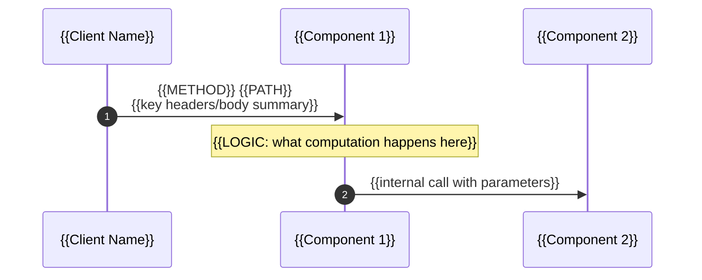
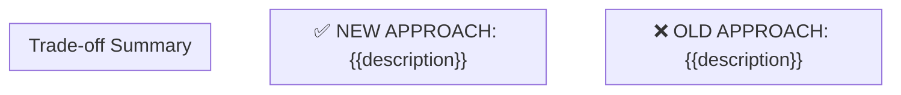

# {{FEATURE_NAME}} — Architecture Diagrams

> Last updated: {{DATE}} ({{VERSION}} — {{VERSION_NOTE}})
> Generated by: feature-docs skill ({{PHASE}})
> Project: `{{SERVICE_NAME}}` | Status: {{VERIFICATION_STATUS}}
> Source: grep-verified against `{{SOURCE_ROOT}}`

---

<!--
╔══════════════════════════════════════════════════════════════════════════════════╗
║  GENERATION INSTRUCTIONS (AI reads this; not included in output)               ║
╠══════════════════════════════════════════════════════════════════════════════════╣
║                                                                                ║
║  APPLICABILITY MATRIX — Which diagrams to generate:                            ║
║  ┌──────────────────────────────────┬───────────────────────────────────────┐   ║
║  │ Feature Type                     │ Diagrams Required                     │   ║
║  ├──────────────────────────────────┼───────────────────────────────────────┤   ║
║  │ New endpoint / feature           │ ALL applicable (1-8)                  │   ║
║  │ Event consumer only              │ 1,3,5,6,7 (skip HTTP sequence)        │   ║
║  │ Pure library / utility           │ 2 only (component hierarchy)          │   ║
║  │ Config-only change               │ SKIP — no architecture diagrams       │   ║
║  │ Cross-cutting (multi-service)    │ ALL + add cross-service sequence      │   ║
║  │ No external dependencies         │ Skip diagrams 5,6 (failure/scaling)   │   ║
║  │ No database                      │ Skip DB-related nodes; mark N/A       │   ║
║  │ No message broker                │ Skip broker nodes; mark N/A           │   ║
║  └──────────────────────────────────┴───────────────────────────────────────┘   ║
║                                                                                ║
║  TECHNOLOGY DETECTION:                                                         ║
║  • Detect deployment model from: Dockerfile, k8s manifests, serverless.yml,   ║
║    docker-compose, Procfile, terraform — use in scaling/deployment diagrams    ║
║  • Detect transport from: annotations, route files, proto files, schema.graphql║
║  • NEVER assume Kafka/Redis/MySQL — grep for actual tech used                 ║
║                                                                                ║
║  MANDATORY DIAGRAMS (generate ALL that apply to the feature):                  ║
║                                                                                ║
║  1. SYSTEM OVERVIEW (C4 Level 2) — always required                             ║
║     • Show ALL external callers/clients                                        ║
║     • Show ALL internal layers (filters, controllers, services, data)          ║
║     • Show ALL external dependencies (DB, cache, broker, APIs)                 ║
║     • Show where this feature fits in the existing architecture                ║
║     • Mark new components with 🆕                                              ║
║     • Use subgraphs to group logically (CLIENTS, SERVICES, STORAGE, etc.)      ║
║                                                                                ║
║  2. COMPONENT/DATA HIERARCHY — if feature has multi-level structure             ║
║     • Show parent-child relationships                                          ║
║     • Show data ownership and sharing boundaries                               ║
║     • Show where state lives (which layer owns what)                           ║
║                                                                                ║
║  3. REQUEST FLOW SEQUENCE — always required                                    ║
║     • Full Mermaid SEQUENCE DIAGRAM for the PRIMARY happy path                 ║
║     • This is a VISUAL diagram (Mermaid sequenceDiagram), NOT textual prose    ║
║     • Complements flow.md which has the TEXTUAL step-by-step                   ║
║     • Show: participant → participant arrows with data/method names             ║
║     • Include timing/data at each arrow                                        ║
║     • Show internal notes for complex steps                                    ║
║     • Use `autonumber` for step references                                     ║
║     • Minimum 10 interactions for non-trivial features                         ║
║                                                                                ║
║  4. FAILURE/REJECTION FLOW — always required                                   ║
║     • Show what happens when the feature REJECTS a request                     ║
║     • Include the exact response body/headers                                  ║
║     • Show cascade effects on other components                                 ║
║                                                                                ║
║  5. ADMIN/OPERATIONS FLOW — if feature has admin/config management             ║
║     • Show how config changes propagate                                        ║
║     • Show cache invalidation paths                                            ║
║     • Show time delays / eventual consistency windows                          ║
║                                                                                ║
║  6. SCALING/DEPLOYMENT VIEW — if feature has distributed concerns              ║
║     • Show per-pod vs shared state                                             ║
║     • Show replication and consistency model                                   ║
║     • Show failure domains                                                     ║
║                                                                                ║
║  7. COMPARISON/TRADE-OFF DIAGRAM — if alternative approaches were considered   ║
║     • Show OLD vs NEW approach side-by-side                                    ║
║     • Highlight trade-offs visually                                            ║
║                                                                                ║
║  8. CONCURRENT ACCESS DIAGRAM — if feature handles concurrent requests         ║
║     • Show multiple clients competing for shared resources                     ║
║     • Show ordering, fairness, atomic operations                               ║
║     • Show what each client sees (responses)                                   ║
║                                                                                ║
║  QUALITY STANDARDS:                                                            ║
║  • Every node in a diagram MUST correspond to a real class/component           ║
║  • Post-spec: nodes can be marked 🆕 (planned, not yet implemented)            ║
║  • Post-impl: ALL nodes must be grep-verified against source                   ║
║  • Arrows must include labels showing what data flows                          ║
║  • Subgraphs must have descriptive titles                                      ║
║  • Use Mermaid syntax (renders in GitHub + IntelliJ with Mermaid plugin)       ║
║  • Include a LEGEND explaining symbols used                                    ║
║  • Include a COMPONENT INVENTORY table at the end (grep-verified)              ║
║                                                                                ║
║  DEPTH:                                                                        ║
║  • Each diagram should have 15-30 nodes minimum for system overview            ║
║  • Sequence diagrams should have 10-20 interactions minimum                    ║
║  • Show REAL data values in labels (not "data" but "1200 records")             ║
║  • Show REAL response codes and headers                                        ║
║  • Notes in sequence diagrams should explain LOGIC, not just label steps       ║
║                                                                                ║
║  DO NOT:                                                                       ║
║  • Generate diagrams from memory — always grep to find real components         ║
║  • Include components that don't exist in source (unless marked 🆕 pre-impl)   ║
║  • Use generic labels ("Service A") — use actual class names                   ║
║  • Skip failure paths — every happy path needs its failure counterpart         ║
╚══════════════════════════════════════════════════════════════════════════════════╝
-->

## Diagram 1 — System Overview (C4 Level 2)

> Scope: All external callers → this service → all dependencies. Shows where {{FEATURE_NAME}} fits in the architecture.

```mermaid
graph TD
    subgraph CLIENTS["External Callers"]
        %% List ALL clients/consumers of this feature
    end

    subgraph SERVICE["{{SERVICE_NAME}}"]
        direction TB

        subgraph LAYER_1["{{First Layer Name}} (e.g., Filter Chain / Interceptors)"]
            %% All components in this layer
        end

        subgraph LAYER_2["{{Second Layer Name}} (e.g., Controllers)"]
            %% All controllers
        end

        subgraph LAYER_3["{{Third Layer Name}} (e.g., Services)"]
            %% All services involved
        end
    end

    subgraph STORAGE["Data Storage"]
        direction LR
        %% All databases, caches, file systems
    end

    subgraph MESSAGING["Message Broker (if applicable)"]
        %% Kafka topics, RabbitMQ queues, etc.
    end

    subgraph DOWNSTREAM["Downstream Services"]
        %% Any services that consume from or are called by this service
    end

    %% Arrows with data labels
```



**Legend:**
| Symbol | Meaning |
|---|---|
| `-->` | Verified direct call / data flow |
| `-.->` | Inferred connection (follows existing pattern) |
| 🆕 | New component (planned or recently implemented) |

---

## Diagram 2 — {{HIERARCHY_OR_STATE_DIAGRAM_TITLE}}

> Shows {{what this diagram illustrates — e.g., data hierarchy, state machine, component ownership}}

```mermaid
graph TD
    %% Show structure/hierarchy/state
```

---

## Diagram 3 — Request Flow: {{SCENARIO_NAME}} (Happy Path)

> Sequence diagram: {{One sentence describing the scenario with real data values}}



---

## Diagram 4 — {{FAILURE_OR_REJECTION_SCENARIO}}

> Shows what happens when {{failure condition}} — including exact response and cascade effects

```mermaid
sequenceDiagram
    autonumber
    %% Same participants as Diagram 3, plus any error handlers

    %% Show the failure path with exact error responses
    %% Include timing if relevant (retries, timeouts)
```

---

## Diagram 5 — {{ADMIN_OR_CONFIG_CHANGE_FLOW}} (if applicable)

> Shows how {{config/admin change}} propagates through the system

```mermaid
sequenceDiagram
    autonumber
    %% Show: admin action → DB update → cache invalidation → propagation delay → new behavior
```

---

## Diagram 6 — {{SCALING_OR_DEPLOYMENT_VIEW}} (if applicable)

> Shows {{distributed concerns — e.g., per-pod state vs shared state, replication}}

```mermaid
graph LR
    %% Show pods, shared resources, consistency boundaries
```

---

## Diagram 7 — {{COMPARISON_OR_TRADEOFF}} (if applicable)

> Trade-off: {{Old approach}} vs {{New approach}}



---

## Diagram 8 — Concurrent Access (if applicable)

> Shows {{N}} clients competing for shared resources simultaneously

```mermaid
sequenceDiagram
    %% Use `par` blocks to show simultaneous requests
    %% Show ordering/fairness/atomic behavior
    %% Show what each client receives
```

---

## Component Inventory (Verified by grep)

<!--
Post-impl: EVERY component mentioned in ANY diagram above must appear here.
Each must be grep-verified. This is the quality gate for architecture diagrams.
-->

| Component | File Path | Role | Verified |
|---|---|---|---|
