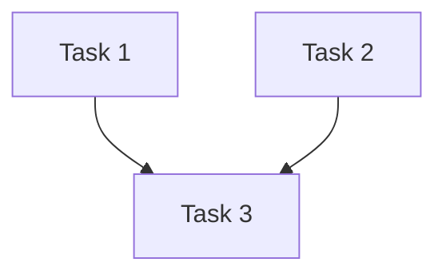

> **EXECUTE AS SCRIPT**: Read Steps 0–N in order. Do not skip any step. Do not proceed to the next step until the current step's check passes.


## Purpose

Create a detailed, dependency-ordered implementation plan from an approved specification. Each task includes exact file paths, actions, size estimates, and blast-radius analysis. Use this skill after a spec is APPROVED and before any code is written.

## Entry Conditions

- `features/<ticket-id>/spec.md` exists with `Status: APPROVED`
- If spec is not APPROVED: **STOP. Spec must be APPROVED before planning. Run spec-writer first. Do not continue.**
- If spec has `Cross-cutting: Yes`:
  - `features/<ticket-id>/lifecycle.md` MUST exist with `Status: APPROVED` (developer typed `APPROVE-LIFECYCLE`)
  - If lifecycle.md is missing or not APPROVED: **STOP. This is a cross-cutting feature. lifecycle.md must be APPROVED before planning. Run lifecycle-flow first. Do not continue.**
- If `features/<ticket-id>/lifecycle.md` exists (regardless of cross-cutting flag), read it as additional context

### Resume Detection (mandatory pre-check)

Before asking clarifying questions, check for existing plan:
1. If `features/<ticket-id>/plan.md` exists with `Status: DRAFT`:
   - Report: "Found existing draft plan for <ticket>."
   - Ask: "Resume editing this plan, or start fresh? [RESUME / FRESH]"
   - On RESUME: read existing plan, continue from where it left off
   - On FRESH: archive existing plan (rename to `plan.md.bak`), start over
2. If `features/<ticket-id>/plan.md` exists with `Status: APPROVED`:
   - Report: "Plan already approved for <ticket>. Use implement-and-test next."
   - STOP unless developer explicitly asks to revise.

## Clarifying Questions

Before proceeding, ask the developer:

- What is the preferred task size — many small tasks or fewer larger ones?
- Are there any high-risk areas where you want extra caution (e.g., additional tests, manual verification)?
- Should any implementation approach be preferred (e.g., extend existing class vs. create new class)?
- Are there any ordering constraints beyond code dependencies (e.g., "deploy config first")?

Proceed only after answers are received.

> **Breadcrumb rule**: Prefix every action with `Step N/M:` per AGENTS.md §Anti-Drift & Context Persistence Protocol.

> 🔒 **Graphify-First (mandatory)**: Before ANY grep in this skill, check if `graphify-out/graph.json` exists. If it does, run `graphify query "what components are involved in <feature area>"` and `graphify path` for change-point identification. Use grep only to supplement or verify. See `.github/instructions/graphify.instructions.md` for full protocol.

## Step 0 — Verify Entry Conditions
```bash
# Verify approved spec exists
grep -rl "Status: APPROVED" features/*/spec-infobip.md 2>/dev/null || echo "MISSING: No approved spec.md — run spec-writer first"
# If cross-cutting: verify lifecycle.md is also approved
grep -rl "Cross-cutting: Yes" features/*/spec-infobip.md 2>/dev/null && grep -rl "Status: APPROVED" features/*/lifecycle.md 2>/dev/null && echo "✅ lifecycle.md approved" || echo "INFO: Not cross-cutting or no lifecycle.md yet"
```
STOP on `MISSING` or missing approved `lifecycle.md` for cross-cutting specs; assess tier from spec scope/risk: `XS / S / M / L / XL`.
Present `Complexity: [TIER] ...`; wait for `YES` or `change to [tier]`; `XS` → route to `implement-and-test`, `XL` → require `features/<ticket-id>/adr.md` first.
Task granularity: `S=file`, `M=component`, `L/XL=slice`.
```bash
# ✓ Check before moving on: Complexity tier confirmed with the developer, or XS/XL redirect requirements cleared.
echo 'Step done: Complexity tier confirmed with the developer, or XS/XL redirect requirements cleared'
```

## Step 1 — Read Inputs

Read `features/<ticket-id>/spec.md` and `features/<ticket-id>/lifecycle.md` (if present). If `features/<ticket-id>/brief.md` exists (from idea-to-spec), read it for additional context. Extract: endpoints, config changes, validation rules, Kafka topics, business rules, acceptance criteria, dependencies, cross-cutting concerns.

```bash
# ✓ Check before moving on: All relevant inputs are parsed and the extracted scope items are noted for plann
echo 'Step done: All relevant inputs are parsed and the extracted scope items'
```
## Step 2 — Identify Change Points

List every class, config file, and test file that must be created or modified. Use grep to confirm each file exists (or note as NEW).

```bash
# ✓ Check before moving on: Every change point is listed with an `EXISTS` or `NEW` status.
echo 'Step done: Every change point is listed with an `EXISTS` or `NEW` statu'
```
## Step 3 — Blast-Radius Analysis

ℹ️ *Tell the developer: "I will now auto-trigger blast-radius on every class and file in the change-point list, grouped by package for reporting only."*

#### 3a — Group Change Points

Before running blast-radius, group the change points from Step 2 by package/module:

<!-- [PROJECT-SPECIFIC] Example packages for this project -->
```
Group 1: com.example.project.service.impl  → [ProducerServiceImpl, RequestValidatorServiceImpl]
Group 2: com.example.project.controller     → [CommunicationController]
Group 3: com.example.project.dto.request     → [CommunicationDTO, Recipients]
```

Classes in the same package often share callers. Grouping avoids redundant grep runs and produces a consolidated view.

#### 3b — Run Blast-Radius Per Group

- **XS tier**: Quick inline check — no formal report; note caller count per group in 1 line.
- **S tier**: Summarize in 1–2 lines per group.
- **M+ tier**: Full blast-radius report per group. Within each group, list per-class callers but share the DI wiring and message-flow sections.

For each group, invoke blast-radius with ALL classes in that group as context so it can deduplicate shared callers. Every class and file from the Step 2 task breakdown must be covered by blast-radius without exception.

```bash
# Verify: blast-radius was run on all change points
echo "Confirm blast-radius output received for every class in the task list above"
```

#### 3c — Aggregate Risk

| Group Risk Levels | Aggregate |
|---|---|
| All LOW | LOW |
| Any MEDIUM, no HIGH/CRITICAL | MEDIUM |
| Any HIGH | HIGH |
| Any CRITICAL or core component touched | CRITICAL |

Record the aggregate and per-group risk in the plan.

**⛔ RISK GATE**:
- If aggregate is **CRITICAL**: **STOP. Present all CRITICAL change points and their callers. Do not proceed to Step 4 until the developer explicitly acknowledges the risks.**
- If aggregate is **HIGH**: **STOP. Present the caller table for all HIGH-risk change points and wait for the developer to choose `APPROVE` or `REVISE: [feedback]`. Do not continue.**
- If aggregate is MEDIUM or LOW: proceed to Step 4 directly.
- **Anything else at this gate** → Clarify: "I need `APPROVE` or `REVISE: [feedback]`."

```bash
# ✓ Check before moving on: Per-group and aggregate blast-risk levels are recorded, and any required risk ga
echo 'Step done: Per-group and aggregate blast-risk levels are recorded, and '
```
## Step 4 — Create Task Breakdown

For each change, create a task entry in this exact format:
```
- [ ] **Task N** [S/M/L] — Description
  - File: `path/to/File.ext`
  - Action: CREATE / MODIFY / DELETE
  - Depends on: Task X (if any)
  - Spec ref: §N.N "Section name"
  - Blast risk: LOW / MEDIUM / HIGH
```
Sizes: **[S]** config/constant/single-field (~1-30 lines changed). **[M]** new class following existing pattern, test class (~30-150 lines). **[L]** new subsystem, core pipeline change, multi-class feature (~150+ lines or 3+ new files).
 
```bash
# ✓ Check before moving on: Every task entry includes file path, action, dependency, spec reference, and bla
echo 'Step done: Every task entry includes file path, action, dependency, spe'
```
**Tier adjustment**: For **XS**, inline 1-3 tasks in conversation (no file). For **S**, tasks only. For **M+**, full format.

## Step 5 — Order Tasks by Dependency

Tasks that create files come before tasks that reference them.

```bash
# ✓ Check before moving on: Task order is dependency-safe, or a circular dependency is surfaced for develope
echo 'Step done: Task order is dependency-safe, or a circular dependency is s'
```
- **STOP. Tasks [A] and [B] have a circular dependency. Present the resolution options below and do not continue.**
  "Tasks [A] and [B] have a circular dependency. Options:
  1. Break the cycle by introducing an interface
  2. Merge them into a single task
  3. Redefine scope to eliminate the dependency
  Which approach do you prefer?"

## Step 6 — Write Plan
Create `features/<ticket-id>/plan.md`. Use `impl-template.md` if present; otherwise use:
```markdown
# Implementation Plan: [Ticket ID] — [Feature Name]
**Status**: DRAFT · **Complexity**: XS / S / M / L / XL · **Aggregate Risk**: LOW / MEDIUM / HIGH / CRITICAL
## Tasks
### Task 1: [Name]
- **File**: `src/...` · **Action**: [create / modify / delete]
- **Description**: [what to do] · **Blast Risk**: LOW / MEDIUM / HIGH
- **Depends on**: [Task N or none] · **Est. size**: XS(<30) / S(30-80) / M(80-150) / L(150+) lines
[repeat for each task]
## Dependency Graph

## Blast-Radius Summary
| Class | Risk | Callers |
|---|---|---|
| [ClassName] | MEDIUM | [count] |
```
Set `Status: DRAFT`; present for `APPROVE` or `REVISE: [feedback]`.
Mermaid graph must match all `Depends on` fields.
Aggregate risk: any `HIGH` or 3+ `MEDIUM` → `HIGH`; core component or >20 callers → `CRITICAL`; else highest task risk.
Tier adjustments: `XS` skip `plan.md`; `S` tasks only; `M` full template; `L` add rollback; `XL` add rollback + reference approved `adr.md`.
```bash
# ✓ Check before moving on: `features/<ticket-id>/plan.md` exists with the required sections for the selected tier.
ls features/*/plan.md 2>/dev/null && grep 'Status:' features/*/plan.md | head -3
```
```bash
# Verify: plan.md was created with correct structure
ls features/*/plan.md && grep "Status: DRAFT\|Status: APPROVED" features/*/plan.md | head -3
```

## Step 7 — Phase Gate
Present: `plan.md ready with [N] tasks (Complexity: [TIER]). Aggregate blast risk: [LEVEL]. Type APPROVE or REVISE: [feedback].`
- `APPROVE` → update `Status: APPROVED`, trigger `feature-docs phase:post-plan`, then offer `implement-and-test` (`[YES / LATER]`).
- `REVISE: [feedback]` → update plan, re-run blast-radius if scope changed, keep `DRAFT`, return here.
- Anything else → clarify: `I need either APPROVE or REVISE: [your feedback].`
```bash
# ✓ Check before moving on: plan.md is either promoted to `Status: APPROVED` with feature-docs triggered, or remains `DRAFT` pending revision.
ls features/*/plan.md 2>/dev/null && grep 'Status:' features/*/plan.md | head -3
```

## Exit Conditions / Done Definition

- `features/<ticket-id>/plan.md` exists on disk
- Every task has file path, action, size, spec reference, and blast-risk level
- Tasks are ordered so no task references an uncreated dependency
- Aggregate blast-risk level is stated in the plan header
- `Status: APPROVED` is set in the plan header
- Developer has explicitly typed APPROVE

## Sub-Agents

| Sub-Agent | Trigger | Input | Output |
|---|---|---|---|
| `blast-radius` | Step 3b — per package group (not per-file) | Package group + all classes in group + intended change description | Per-group risk level + deduplicated caller list + aggregate risk |
| `feature-docs` | Step 7 — after APPROVED | Approved plan.md content | Feature documentation updates |

## Example Invocation

**Developer says:**
> "Create the implementation plan for COM-045."

**AI responds:**
> "I'll plan the implementation for COM-045. First, a few questions:
> 1. Do you prefer many small tasks or fewer combined tasks?
> 2. Any areas you consider high-risk that need extra attention?
> 3. Any approach preferences (extend vs. new class)?"

*(After answers, AI reads spec, runs blast-radius on each change point, writes plan.md, and presents the Phase Gate.)*

## What I Will NOT Do

- Write any implementation code
- Skip blast-radius analysis on any change point
- Assume classes exist without grep verification
- Create tasks without file paths and actions

### ⚡ Escalation Path

| Stuck At | What Happened | Do This |
|---|---|---|
| Step 3 (blast-radius) | blast-radius returns CRITICAL for a change point | Stop, present safe change patterns, and require APPROVE before including it in the plan. |
| Step 4 (task breakdown) | Cannot determine task dependencies | Use code-explorer to trace class dependencies. Map data flow to determine order. |
| Step 0 (complexity assessment) | Developer disagrees with complexity tier | Present evidence (file count, caller count). Allow override with justification. |
| Step 6 (Mermaid) | Diagram is too complex to render | Split into sub-diagrams by module. Present each separately. |

---

---

## Step 8 — What To Do Next (Always Show This)

**Present this at the end of every run, unconditionally:**

```
━━━━━━━━━━━━━━━━━━━━━━━━━━━━━━━━━━━━━━━━━━
✅ impl-planner — done?
  □ Steps 0–8 executed (including this step)
  □ Verifiable outcomes confirmed
  □ No unresolved stops remain

What next?
  A) Start implementing                     — say: "use the implement-and-test skill for COM-XXX — start with Task 1"
  B) Re-assess risk                         — say: "use the blast-radius skill on [highest-risk class]"
  C) Revise the spec                        — say: "use the spec-writer skill for COM-XXX"
  D) Discuss task ordering                  — say: "use the party-mode skill — [task ordering question]"
  E) Get help                              — say: "help"

⭐ plan is approved, start building.

💾 Save output? "Save as MD? (YES — path / NO)"
━━━━━━━━━━━━━━━━━━━━━━━━━━━━━━━━━━━━━━━━━━
```
