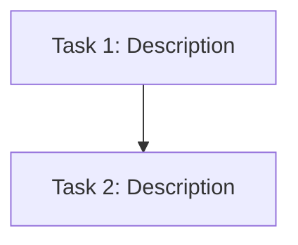

---

> **[PROJECT-SPECIFIC]** — Replace this file when porting to another repository.
Status: DRAFT
Jira: COM-XXX
Spec: features/<ticket-id>/spec.md
Complexity: [XS / S / M / L / XL]
Created: [date]
---

# Implementation Plan: [Title]

## Complexity Assessment
- **Tier**: [XS/S/M/L/XL]
- **Justification**: [one-line reason — e.g., "3 files, follows EventProcessor pattern, 1 integration"]
- **Planning depth**: [Inline / Minimal / Standard / Detailed / Full+ADR]
- **ADR**: [link to features/<ticket-id>/adr.md — XL only, otherwise "N/A"]

## Blast Radius Summary
[Summary from blast-radius analysis — risk level + key findings]

## Tasks

- [ ] **Task 1** [S] — Description
  - File: `path/to/file`
  - Action: CREATE / MODIFY / ADD / DELETE
  - Depends on: [Task N or "none"]
  - Spec ref: §N.N "Section"
  - Blast risk: [LOW / MEDIUM / HIGH]

## Task Dependency Graph

## Task Dependencies
[Which tasks depend on others — execution order]

## Risk Assessment
- Overall risk: [LOW / MEDIUM / HIGH / CRITICAL]
- Core pipeline touched: [Yes/No]
- Test coverage plan: [Which tests to add/update]

## Rollback Strategy (L/XL tier only)
[If deployment fails, revert by: specific steps. Include: which config to roll back, which feature flags to disable, which DB changes to undo.]

## Architecture Decision Record (XL tier only)
See: `features/<ticket-id>/adr.md` (created before planning — template in impl-planner/SKILL.md)
