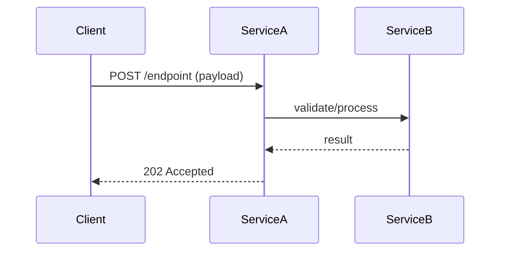
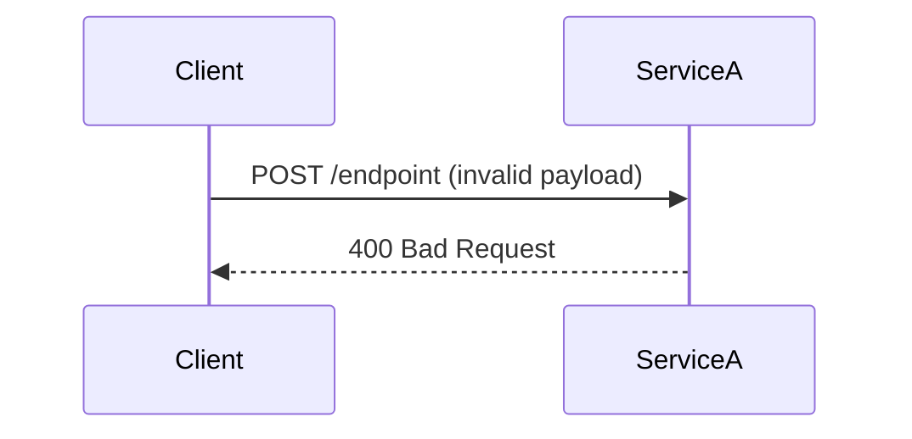

> **EXECUTE AS SCRIPT**: Read Steps 0–N in order. Do not skip any step. Do not proceed to the next step until the current step's check passes.


> **[PROJECT-SPECIFIC — TEMPLATE]** — This is a Layer 2 skill that lives in `generic/` as a **reusable template**. The grep patterns and class references below are examples from `communication-dispatcher`. When `link-skills.sh` installs this for a new project, the project overlay can replace this file entirely with project-specific paths. If no project overlay exists, the AI MUST adapt grep patterns using the §Auto-detection protocol in AGENTS.md (detect stack → use appropriate patterns). Do NOT run communication-dispatcher grep paths against a different project.

## Purpose

Generate Mermaid sequence diagrams for cross-cutting features that span multiple components in the REST→Kafka dispatch pipeline. This skill is **domain-specific** to the the target project's gateway architecture.

Use when:
- A spec says `Cross-cutting: Yes` (auto-triggered after spec approval)
- A feature touches multiple pipeline stages (security, validation, config, Kafka)
- You need to visualize how a notification request travels from REST ingestion to Kafka publish

**Skip when**: Change is a config-only update, single-class bug fix, or new API key addition.

## Entry Conditions

- `features/<ticket-id>/spec.md` exists with `Status: APPROVED`
- Spec §7 (Lifecycle Impact) says `Cross-cutting: Yes`
- If spec says `Cross-cutting: No`: **STOP. Spec indicates single-component change. Skip lifecycle-flow and proceed to impl-planner. Do not continue.**
- If no spec exists: **STOP. Run spec-writer first. Do not continue.**

## Clarifying Questions

Before tracing flows, ask:

- Which endpoint(s) are involved? (v1, v2, v2/country, config, scheduler)
- Which pipeline stages does this flow touch? (security / validation / config lookup / Kafka publish / scheduler)
- Are there cross-service dependencies? (the target project downstream, other Kafka consumers, external APIs)
- Should I trace the existing flow (documentation) or propose a new flow (pre-implementation)?

Proceed only after answers are received.

> **Breadcrumb rule**: Prefix every action with `Step N/M:` per AGENTS.md §Anti-Drift & Context Persistence Protocol.

> 🔒 **Graphify-First (mandatory)**: Before ANY grep in this skill, anchor to the repo root with `cd "$(git rev-parse --show-toplevel)"`, then check if `graphify-out/graph.json` exists (a "graph file not found" error from a subdirectory is NOT a missing graph). If it does, run `graphify path "<ServiceA>" "<ServiceB>"` to map cross-service flows from the knowledge graph first. Use grep only to supplement or verify. See `.github/instructions/graphify.instructions.md` for full protocol.

## Step 0 — Verify Entry Conditions

```bash
# Verify approved spec with Cross-cutting: Yes exists
grep -rl "Status: APPROVED" features/*/spec-infobip.md 2>/dev/null | xargs grep -l "Cross-cutting: Yes" 2>/dev/null \
  || echo "MISSING: Need an approved spec.md with 'Cross-cutting: Yes' before running lifecycle-flow"
```
**STOP. If the check above shows MISSING, run spec-writer first and ensure spec is APPROVED with Cross-cutting: Yes.**

## Step 1: Identify Entry Points

<!-- [PROJECT-SPECIFIC] Adapt grep patterns below to your codebase. These examples are for Java/Spring Boot. -->

```bash
# REST controllers
grep -rn "@RestController" src/main/java/ --include="*.java" -l

# REST endpoints
grep -rn "@PostMapping\|@GetMapping" src/main/java/ --include="*.java"

# Kafka consumers (CDC)
grep -rn "@KafkaListener" src/main/java/ --include="*.java"

# Scheduled tasks
grep -rn "@Scheduled" src/main/java/ --include="*.java"
```

```bash
# ✓ Check before moving on: All entry points are listed with file paths confirmed via grep.
echo 'Step done: All entry points are listed with file paths confirmed via gr'
```
## Step 2: Trace Request Processing Path

<!-- [PROJECT-SPECIFIC] These paths are specific to communication-dispatcher. Adapt for your project. -->

```bash
# Security filter chain
grep -rn "doFilterInternal\|shouldNotFilter" src/main/java/com/maf/oms/communication/security/ --include="*.java"

# Controller → Service delegation
grep -rn "validateAndSend\|sendNotification" src/main/java/com/maf/oms/communication/controller/ --include="*.java"

# Validation logic
grep -rn "validate\|isValid" src/main/java/com/maf/oms/communication/service/impl/RequestValidatorServiceImpl.java

# Config lookup chain
grep -rn "findConfigById\|getConfigId" src/main/java/ --include="*.java"

# Kafka publish
grep -rn "sendMessage" src/main/java/com/maf/oms/communication/producer/ --include="*.java"
```

```bash
# ✓ Check before moving on: Each component's role in the request path is documented with verified method sig
echo 'Step done: Each component's role in the request path is documented with'
```
## Step 3: Trace Config & Infrastructure Paths

<!-- [PROJECT-SPECIFIC] These paths are specific to communication-dispatcher. Adapt for your project. -->

```bash
# Redis → MongoDB circuit breaker fallback
grep -rn "CircuitBreaker\|fallback" src/main/java/com/maf/oms/communication/circuitbreaker/ --include="*.java"

# Priority topic resolution
grep -rn "high-priority\|medium-priority\|low-priority\|topic" src/main/resources/ --include="*.yml"

# Country-specific routing
grep -rn "maf-account\|country\|sendNotificationWithCountry" src/main/java/ --include="*.java"

# Scheduler → CommunicationClient
grep -rn "CommunicationClient\|sendScheduledCommunication" src/main/java/ --include="*.java"
```

```bash
# ✓ Check before moving on: All async boundaries, config lookups, and infrastructure/message-flow paths are 
echo 'Step done: All async boundaries, config lookups, and infrastructure/mes'
```
## Step 4: Generate Mermaid Sequence Diagram

Create `features/<ticket-id>/lifecycle.md`. Use [lifecycle-template.md](lifecycle-template.md) if it exists — otherwise use this inline template:

```markdown
# Lifecycle Flow: [Ticket ID] — [Feature Name]

**Status**: DRAFT
**Participants**: [list all services/components involved]

## Happy Path



## Error Paths



## Notes
- [Any cross-cutting concerns or fallback behavior]
```

Notation: `-->>` normal response, `--)` async, `--x` failure, `alt/else` branching.
Every participant MUST be verified to exist in source code before including.
- REST request and authentication (SecurityFilter)
- Full request flow from controller → validator → config lookup → producer → Kafka
- Config lookup chain (Redis → MongoDB via circuit breaker)
- Priority topic resolution (high/medium/low based on config)
- Error paths (400 validation failure, 401 unauthorized, 500 internal error)
- Country-specific routing for BHR/KWT (x-maf-account header)

The sequence diagram MUST include:
- Happy path (solid arrows)
- Error/reject path (dashed arrows labeled with HTTP status)
- Circuit breaker fallback path (Redis down → MongoDB)
- Multi-topic publish sequence (high → medium → low with Thread.sleep between)

Use Mermaid notation: `-->>` for normal flow, `--)` for async, `--x` for failure, `alt/else` for branching.

```bash
# Verify: lifecycle.md was created
ls features/*/lifecycle.md && head -5 features/*/lifecycle.md
```

```bash
# ✓ Check before moving on: Mermaid diagram renders without syntax errors, every participant is verified in 
ls features/*/lifecycle.md 2>/dev/null && head -3 features/*/lifecycle.md
```
**⛔ DIAGRAM GATE**: After generating `lifecycle.md`, architecture-diagrammer MUST be triggered. This is not optional.

- If architecture-diagrammer succeeds: embed or reference the diagram in `lifecycle.md`. Add `Last updated` header to the diagram file.
- If architecture-diagrammer fails or returns no output: **WARN + RETRY** — "architecture-diagrammer did not complete. Retrying once." If second attempt also fails: ask developer: "Diagram generation failed. Proceed without diagram? [YES / NO]". If YES → mark lifecycle.md as complete with note `<!-- Diagram: PENDING — manual creation needed -->`. If NO → **STOP. Diagram generation failed and the developer did not approve a skip. Do not continue.**
- Do NOT mark lifecycle.md complete or present it to the developer until the diagram gate is resolved (success OR developer-approved skip).

After generating the lifecycle.md sequence diagram, auto-trigger `architecture-diagrammer` to:
- Produce a component interaction diagram showing all classes involved in this flow
- Embed or reference the diagram in lifecycle.md

**Kafka Schema Change Detection**:
If the feature modifies the Kafka message payload (adds/removes/renames fields in CommunicationDTO or notificationData):
- **⚠️ WARNING**: This affects all downstream Kafka consumers (the target project)
- Document: old payload vs. new payload
- Note: all consumers of the topic must be updated
- Recommend: use backward-compatible changes (add optional fields, don't remove/rename)

## Step 5: Component Impact Table

List every component touched with role and risk level:

| Component | Role | Impact | Risk |
|---|---|---|---|
| SecurityFilter | Authentication | Validates x-api-key header | LOW (no change) |
| CommunicationController | Entry point | Routes to ProducerServiceImpl | LOW |
| RequestValidatorServiceImpl | Validation | Validates payload structure | MEDIUM (new validation rule) |
| ConfigServiceCircuitBreakerImpl | Config lookup | Redis → MongoDB fallback | LOW (no change) |
| ProducerServiceImpl | Orchestration | Validates, looks up config, publishes to Kafka | HIGH (core path) |
| KafkaProducer | Publishing | Sends to priority topic | LOW (no change) |

```bash
# ✓ Check before moving on: Component impact table is complete and each listed component has a documented ro
echo 'Step done: Component impact table is complete and each listed component'
```
## Step 6: Present for Review & Approval Gate

Show the lifecycle.md to the developer:
```
Here is the cross-cutting flow diagram for [ticket-id]:
[paste lifecycle.md content]

Type APPROVE-LIFECYCLE to proceed to impl-planner.
Type REVISE-LIFECYCLE: [feedback] to update the diagram.
```

```bash
# Verify: lifecycle.md exists and has a sequenceDiagram block
ls features/*/lifecycle.md && grep -c "sequenceDiagram" features/*/lifecycle.md
```


## Exit Conditions / Done Definition

- [ ] `features/<ticket-id>/lifecycle.md` created with Mermaid sequence diagram
- [ ] Every component in the diagram verified by grep (no invented classes)
- [ ] Component impact table complete with risk levels
- [ ] Cross-service dependencies documented (if any)
- [ ] **⛔ DIAGRAM GATE passed** — architecture-diagrammer completed and diagram embedded/linked in lifecycle.md
- [ ] Developer has typed exact token `APPROVE-LIFECYCLE` (or `REVISE-LIFECYCLE: [feedback]` to iterate)

## Sub-Agents

| Sub-Agent | When Triggered | Input | Output |
|---|---|---|---|
| `code-explorer` | When a component's role in the flow is unclear | Class name | Explanation of purpose + dependencies |
| `architecture-diagrammer` | After lifecycle.md created — Step 4 | Feature scope + involved components | Component interaction diagram |

## Example Invocation

**Developer:** "use the lifecycle-flow skill for COM-045"

**AI Response:**
```
Reading features/COM-045-rate-limiting/spec.md...
Spec says Cross-cutting: Yes — touches security, validation, and controller layers.

Before I map the flow, let me confirm:
- Feature: per-service rate limiting on v2 endpoint
- Pipeline stages: SecurityFilter → CommunicationController → ProducerServiceImpl
- Cross-service: No downstream impact (rate limiting is pre-Kafka)

I'll trace the existing request pipeline and show where rate limiting plugs in.

[runs grep commands, generates Mermaid diagram]

Lifecycle flow mapped. 4 components involved:
SecurityFilter → CommunicationController → RequestValidatorServiceImpl → ProducerServiceImpl
New RateLimiterFilter inserted between SecurityFilter and CommunicationController.

See features/COM-045-rate-limiting/lifecycle.md for the full diagram.
```

## What I Will NOT Do

- Modify any code — this is analysis and documentation only
- Generate diagrams for single-component changes (skip to impl-planner)
- Assume components exist without grep verification
- Invent cross-service dependencies not evidenced in the codebase

---

### ⚡ Escalation Path

| Stuck At | What Happened | Do This |
|---|---|---|
| Step 2 (flow mapping) | Cannot determine request payload structure | Check CommunicationDTO and related DTOs. If schema is undocumented, **STOP. Ask the developer for the schema definition. Do not continue.** |
| Step 4 (Mermaid) | Flow spans too many components — diagram unreadable | Split into sub-flows: ingestion flow + config flow + publish flow. Link them with notes. |
| Step 5 (error paths) | Cannot determine error handling for a step | Grep for try/catch in the handler class. If no error handling exists, flag as a gap in the flow. |
| Step 6 (review) | Developer says flow is wrong | Ask which step is incorrect. Update Mermaid diagram. Re-present for review. |

---

## Step 7 — What To Do Next (Always Show This)

**Present this at the end of every run, unconditionally:**

```
━━━━━━━━━━━━━━━━━━━━━━━━━━━━━━━━━━━━━━━━━━
✅ lifecycle-flow — done?
  □ Steps 0–7 executed (including this step)
  □ Verifiable outcomes confirmed
  □ No unresolved stops remain

What next?
  A) Explore a component                    — say: "use the code-explorer skill — [component from flow]"
  B) Broader architecture view              — say: "use the architecture-diagrammer skill"
  C) Discuss flow design                    — say: "use the party-mode skill — [flow design question]"
  D) Get help                              — say: "help"

⭐ flow is mapped, move to implementation planning.

💾 Save output? "Save as MD? (YES — path / NO)"
━━━━━━━━━━━━━━━━━━━━━━━━━━━━━━━━━━━━━━━━━━
```
