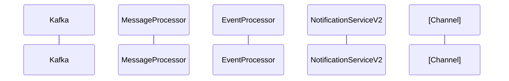

---

> **[PROJECT-SPECIFIC]** — Replace this file when porting to another repository.
Jira: COM-XXX
Spec: features/<ticket-id>/spec.md
Created: [date]
---

# Lifecycle Flow: [Title]

## Trigger
[What event starts this flow]

## Sequence Diagram

## Components Touched
| Component | Role in Flow | Impact |
|---|---|---|

## Cross-Service Dependencies
[Other services affected, Kafka schemas shared, etc.]
